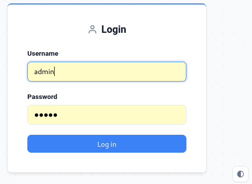
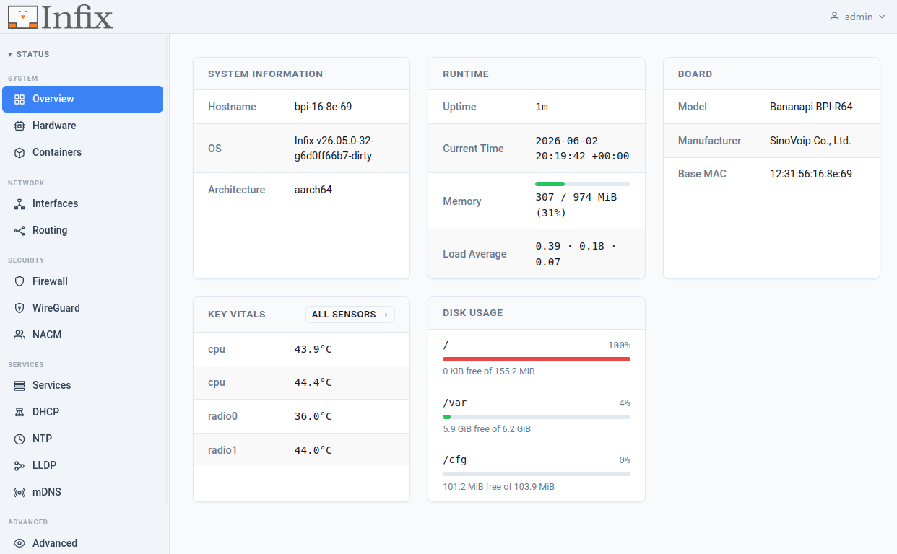
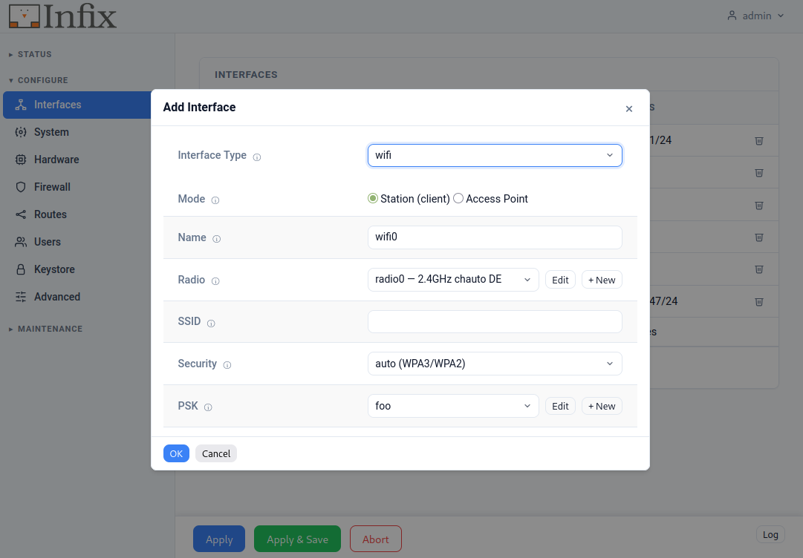
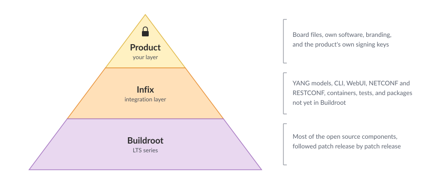

[![License Badge][]][License] [![Release Badge][]][Release] [![GitHub Status][]][GitHub] [![Coverity Status][]][Coverity Scan] [![Discord][discord-badge]][discord-url]

Infix turns an ARM, RISC-V, or x86 device into a managed network appliance:
a router, a switch, an IoT gateway, or the base of your own product.  The
same OS runs on a Raspberry Pi and on enterprise switching hardware.

Getting started:

- Pick a board from the [supported boards][boards] post, updated as new ports land
- Get a [pre-built image][5] for your board, or the `x86_64` image for any VM
- [Build from source and `make run`][build-post] to boot the result in QEMU
- Run a whole network of Infix nodes in [GNS3][gns3-post]
- 📖 [User Guide][4] • 📝 [Blog][6] • 💬 [Discord][discord-url]

> [!TIP]
> The *[Latest Build][]* has everything merged since the last release.
> Log in with `admin` / `admin` on the virtual and pre-built images.
> Products built on Infix set their own password, usually unique per
> device.

## See it in action

The CLI is generated from the [YANG models][inside], so it guides you with
built-in help.  Here's setting an IP address on an interface:

<pre><code>admin@infix-12-34-56:/> <b>configure</b>
admin@infix-12-34-56:/config/> <b>edit interface eth0</b>
admin@infix-12-34-56:/config/interface/eth0/> <b>set ipv4</b> <kbd>TAB</kbd>
      address     autoconf      bind-ni-name     dhcp 
      enabled     forwarding    mtu              neighbor
admin@infix-12-34-56:/config/interface/eth0/> <b>set ipv4 address 192.168.2.200 prefix-length 24</b>
admin@infix-12-34-56:/config/interface/eth0/> <b>show</b>
type ethernet;
ipv4 {
  address 192.168.2.200 {
    prefix-length 24;
  }
}
admin@infix-12-34-56:/config/interface/eth0/> <b>diff</b>
interfaces {
  interface eth0 {
+    ipv4 {
+      address 192.168.2.200 {
+        prefix-length 24;
+      }
+    }
  }
}
admin@infix-12-34-56:/config/interface/eth0/> <b>leave</b>
admin@infix-12-34-56:/> <b>show interfaces</b>
<u>INTERFACE       PROTOCOL   STATE       DATA                                  </u>
lo              ethernet   UP          00:00:00:00:00:00
                ipv4                   127.0.0.1/8 (static)
                ipv6                   ::1/128 (static)
eth0            ethernet   UP          52:54:00:12:34:56
                ipv4                   192.168.2.200/24 (static)
                ipv6                   fe80::5054:ff:fe12:3456/64 (link-layer)
admin@infix-12-34-56:/> <b>copy running startup</b>
</code></pre>

<kbd>TAB</kbd> completes and <kbd>?</kbd> shows help for every option.
`diff` shows what changed before `leave` commits it.  See the [CLI
documentation][3] for more.

The same configuration is available from a browser.  The Status Overview
dashboard keeps an eye on the device, the interface setup wizard under
Configure builds the common setups, or fold out an interface and add an
address.

  
  
  

The web interface follows the CLI: status and configuration are kept
apart, and both come from the same YANG models.

## Make it your own

<a href="https://bitsign.se">
  <picture>
    <source media="(prefers-color-scheme: dark)" srcset="doc/img/bitsign-badge-dark-mode.png">
    <source media="(prefers-color-scheme: light)" srcset="doc/img/bitsign-badge-light-mode.png">
    
  </picture>
</a>

Buildroot supplies the open source base, and Infix follows each patch
release of its LTS series.  The layer above adds the YANG models, the
CLI and web interface, [NETCONF][] and [RESTCONF][], container support,
automated regression tests, and packages not yet in Buildroot.

A product is built on top of that as a *spin*: a small br2-external
tree with Infix as a submodule, holding the board files, the vendor's
own software and branding, and the vendor's own signing keys.  The
[spin example][spin] is the skeleton the products built on Infix start
from, and [Branding & Releases][branding] walks through the settings.

The public images are the middle layer, built from this tree, and signed
with a *development key* that is also in this tree.  The signature says
the image is intact, not who made it.

A spin replaces that key with its own and enables secure boot where
the hardware supports it, see [Signing Keys][keys].  All products built
on Infix by [Wires][] are signed through [bitSign][].

## Our values

*Immutable. Friendly. Secure.*  The tagline on the logo is also the
design brief, and most of what is under the hood follows from it.

**🔒 Immutable**  
Read-only filesystem with atomic upgrades.  An update either applies
cleanly or rolls back, so a failed upgrade or a power cut midway through
won't leave you with a half-broken system.  There are two system
partitions, and an upgrade only ever writes to the one not running.

**🤝 Friendly**  
The CLI is generated from the YANG models, so every command carries its
own help: hit <kbd>?</kbd> or <kbd>TAB</kbd> to see what's available.
The web interface, NETCONF and RESTCONF come from the same models.  The
[User Guide][4] ships inside the image, one click away in the web
interface, so help is there even when the Internet is not.

**🛡️ Secure**  
A small attack surface, separation between system and data, and
container isolation.  Since the system partition is read-only, a
compromised service or container can't rewrite the OS underneath it.
A spin adds its own signing keys and secure boot, see above.

Built on [Linux][0], [Buildroot][1], and [sysrepo][2].  Switchdev
offload gives wire-speed forwarding on switch hardware, and all of it
runs on devices with 512 MB RAM.  The [Inside Infix][inside] post walks
through how the pieces fit together.

## Contributing

Bug reports, ideas, and pull requests are welcome.  Start with
[CONTRIBUTING][contributing] and the [code of conduct][coc].  Found a
security issue?  Follow the [security policy][security].  Need a hand?
See [support options][support] or [join us on Discord][discord-url].

Wondering how long a given version keeps receiving updates, and what
goes into a patch release?  See [releases & support][releases].

---

  
   Infix development is sponsored by <a href="https://wires.se">Wires</a>

[0]: https://www.kernel.org
[1]: https://buildroot.org/ "Buildroot Homepage"
[2]: https://www.sysrepo.org/ "Sysrepo Homepage"
[3]: https://www.kernelkit.org/infix/latest/cli/introduction/
[4]: https://www.kernelkit.org/infix/
[5]: https://github.com/kernelkit/infix/releases/latest
[6]: https://www.kernelkit.org/
[inside]:          https://www.kernelkit.org/posts/inside-infix/
[gns3-post]:       https://www.kernelkit.org/posts/infix-in-gns3/
[build-post]:      https://www.kernelkit.org/posts/building-infix-from-source/
[contributing]:    .github/CONTRIBUTING.md
[coc]:             .github/CODE_OF_CONDUCT.md
[security]:        .github/SECURITY.md
[support]:         .github/SUPPORT.md
[releases]:        doc/releases.md
[Latest Build]:    https://github.com/kernelkit/infix/releases/tag/latest "Latest build"
[boards]:          https://www.kernelkit.org/posts/router-boards/
[keys]:            doc/boot.md#signing-keys
[spin]:            https://github.com/kernelkit/infix-spin-example
[branding]:        doc/branding.md
[NETCONF]:         https://datatracker.ietf.org/doc/html/rfc6241 "RFC 6241"
[RESTCONF]:        https://datatracker.ietf.org/doc/html/rfc8040 "RFC 8040"
[Wires]:           https://wires.se
[bitSign]:         https://bitsign.se
[License]:         https://en.wikipedia.org/wiki/GPL_license
[License Badge]:   https://img.shields.io/badge/License-GPL%20v2-blue.svg
[Release]:         https://github.com/kernelkit/infix/releases/latest
[Release Badge]:   https://img.shields.io/github/v/release/kernelkit/infix 
[GitHub]:          https://github.com/kernelkit/infix/actions/workflows/trigger.yml/
[GitHub Status]:   https://github.com/kernelkit/infix/actions/workflows/trigger.yml/badge.svg
[Coverity Scan]:   https://scan.coverity.com/projects/29393
[Coverity Status]: https://scan.coverity.com/projects/29393/badge.svg
[discord-badge]:   https://img.shields.io/discord/1182652155618918411.svg?logo=discord
[discord-url]:     https://discord.gg/6bHJWQNVxN
