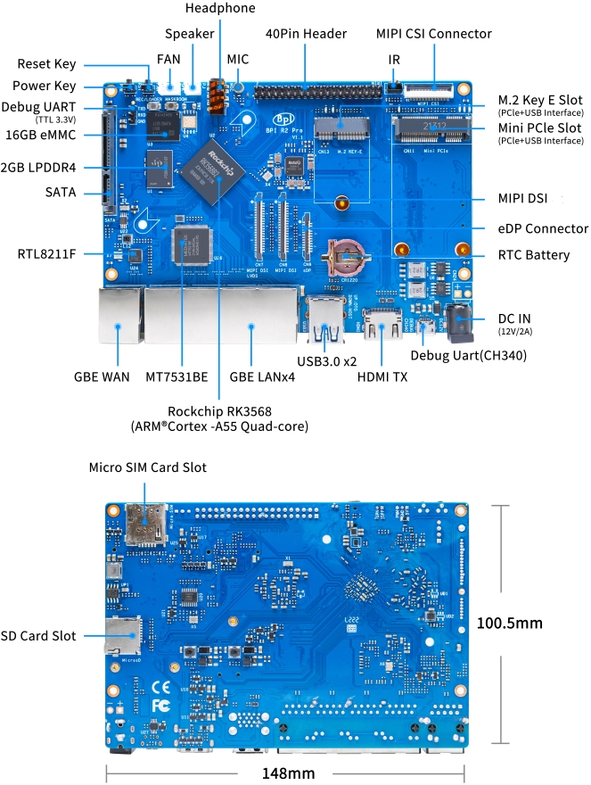

# Banana Pi BPI-R2 Pro

## Overview



The Banana Pi BPI-R2 Pro is a networking board based on the Rockchip
RK3568 (quad Cortex-A55, AArch64) SoC.

### Hardware Features

- Rockchip RK3568 quad-core ARM Cortex-A55
- 2 GB LPDDR4 RAM
- 16 GB eMMC storage
- microSD card slot
- MT7531 Gigabit Ethernet switch (4x LAN), 1 Gbps RGMII to the CPU
- RTL8211F Gigabit Ethernet PHY (1x WAN)
- 2x USB 3.0 ports, usb1 (upper) and usb2 (lower)
- Mini PCIe (CN11) and M.2 Key-E (CN13) slots
- SATA

### Default Network Configuration

The factory config bridges lan1-lan4 and runs a DHCP client on wan.

## Getting Started

### Quick Start with SD Card

1. Flash the image to an SD card:

   ```sh
   dd if=infix-*-bpi-r2-pro-sdcard.img of=/dev/sdX bs=4M status=progress
   ```

2. Insert the SD card and power on
3. Connect a console, 1500000 8N1, to the micro-USB DEBUG port (CH340)
   or the TXD/RXD/GND header next to the REC/LOADER button
4. Log in as `admin`, password `admin`

## Installing to eMMC

The same image boots from both SD card and eMMC.  Boot from SD and write
the image to the eMMC, `/dev/mmcblk1`, from a PC on one of the LAN ports:

```sh
ssh admin@192.168.0.1 sudo dd of=/dev/mmcblk1 bs=4M conv=fsync < infix-bpi-r2-pro-sdcard.img
```

Power off, remove the SD card, and power on.

### From U-Boot

Without a network, write the image from U-Boot using a FAT32-formatted
USB drive:

```
usb start
fatload usb 0:1 0x10000000 infix-bpi-r2-pro-sdcard.img
setexpr blocks ${filesize} / 0x200
mmc dev 1
mmc write 0x10000000 0x0 ${blocks}
```

Power off, remove the SD card and USB drive, and power on.

## Platform Notes

### mmc0 = SD, mmc1 = eMMC

U-Boot tries the SD card (mmc0) first, then eMMC (mmc1).  Linux uses the
same numbers, `/dev/mmcblk0` is the SD card and `/dev/mmcblk1` the eMMC.

### Mini PCIe Modems

The Mini PCIe slot (CN11) has its PCIe lanes wired, so a USB 3.0 modem
like the Quectel EP06-E or Sierra Wireless MC7455 must be set to USB
2.0 before it shows up, see [USB 3.0 Modem in a Mini PCIe Slot][modem].

[modem]: ../../../doc/modem.md#usb-30-modem-in-a-mini-pcie-slot

### DDR Init Blob

The DDR init (TPL) is a closed binary from [rkbin][], built into
`idbloader.img`.  BL31 is built from upstream TF-A.

[rkbin]: https://github.com/rockchip-linux/rkbin

## Building

```sh
# Bootloader
make O=x-boot-bpir2pro bpi_r2_pro_boot_defconfig && make O=x-boot-bpir2pro

# Compose the image (pass the Infix rootfs output directory)
utils/mkimage.sh -b x-boot-bpir2pro -r x-aarch64/images bananapi-bpi-r2-pro
```
