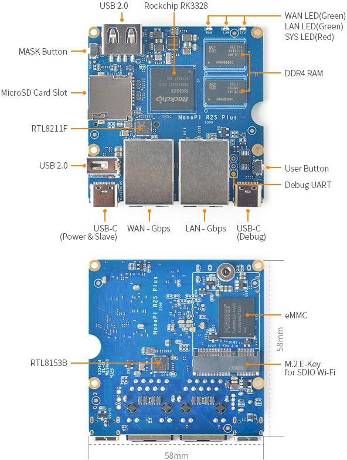

FriendlyELC NanoPi R2S
======================



The [NanoPi R2S][1] is a very low-cost 64-bit ARM min router, powered by the
Rockchip RK3328, quad-core Cortex-A53.

The R2S does not have any onboard eMMC, so the only way to boot Infix on it is
using and SD card.  The R2S Plus adds a 32 GiB eMMC and a MASK button, see
[NanoPi R2S Plus][2] product page or the details worth knowing about it in
Infix, [below](#nanopi-r2s-plus).

See the [blog post][3] for more details.

LEDs
----

The front system LEDs work as follows in Infix:

| **Stage**      | **SYS** | **LAN** | **WAN** |
|----------------|---------|---------|---------|
| Power-on       | dimmed  | off     | off     |
| Factory reset  | on      | on      | on      |
| Linux loading  | on      | off     | off     |
| System loading | 1 Hz    | off     | off     |
| System up      | off     | on      | off     |
| WAN address    | off     | on      | on      |
| Locate         | 1 Hz    | 1 Hz    | 1 Hz    |
| Fail safe      | 5 Hz    | off     | off     |
| Panic          | 5 Hz    | 5 Hz    | 5 Hz    |

Powering on the device the SYS LED is turned on faintly (dimmed).  It
remains dimmed while U-Boot loads the kernel, and turns bright red when
the kernel starts.  It remains steady on until the system has started
the LED daemon, `iitod`, which sets it blinking at 1 Hz while the rest
of the system starts up.  When the system has come up successfully, the
SYS LED is turned off and the green LAN LED turns on.  The WAN LED will
turn on (green) when the WAN interface is up and has an IP address.

> Compared to the `x86_64` Qemu target, it takes a while to parse all
> YANG models and load `startup-config`, but the whole process should
> not take more than 60 seconds, and usually a lot less.

If a "find my device" function exists, it will blink all LEDs at 1 Hz.

If `startup-config` fails to load Ínfix reverts to `failure-config`,
putting the device in fail safe (or fail secure) mode.  Indicated by
the SYS LED blinking at 5 Hz instead of turning off.

If Infix for some reason also fails to load `failure-config`, then all
LEDs will blink at 5 Hz to clearly indicate something is very wrong.

In all error cases the console shows the problem.


Factory Reset
-------------

The reset button on the side can be used not only to safely reboot the
device, but can also be used to trigger a factory reset at power on.

At power-on, keep the reset button pressed for 10 seconds.  The system
LEDs (SYS, WAN, LAN) will all blink at 1 Hz, to help you count down the
seconds.  When the 10 seconds have passed all LEDs are turned off before
loading Linux.

When Linux boots up it confirms the factory reset by lighting up the
LEDs again, no blinking this time.  The LEDs stay on until all files and
directories on read/writable partitions (`/cfg` and `/var`) have been
safely erased.

The system then continues loading, turning off all LEDs except SYS,
which blinks calmly at 1 Hz as usual until the system has completed
loading, this time with a `startup-config` freshly restored from the
device's `factory-config`.


How to Build
------------

```
$ make r2s_defconfig
$ make
```

Once the build has finished you will have `output/images/sdcard.img`
which you can flash to an SD card.

```
$ sudo dd if=output/images/sdcard.img of=/dev/mmcblk0 bs=1M status=progress oflag=direct
```

> **WARNING:** ensure `/dev/mmcblk0` really is the correct device for
> your SD card, and not used by the system!


Booting the Board
-----------------

 1. Connect a TTL cable to three UART pins, GND is closest to the edge
 2. Insert the flashed SD card
 3. Power-up the board using an USB-C cable (ensure good power source!)

Worth noting, unlike many other boards, the Rockchip family of chipsets
runs the UART at 1500000 bps (1.5 Mbps) 8N1.


NanoPi R2S Plus
---------------

The same SD card image boots both the R2S and the R2S Plus.  U-Boot
detects the eMMC and loads the matching device tree.

The boot ROM tries the eMMC before the SD card.  Hold the MASK button at
power-on to skip the eMMC, e.g., when it holds FriendlyWrt or a broken
install.  To boot from the SD card without the MASK button, erase the
eMMC from the U-Boot prompt:

```
(r2s) mmc dev 0
(r2s) gpt write mmc 0 "name=blank,size=-"
(r2s) mmc erase 40 7fc0
```

To install Infix on the eMMC, boot from the SD card, copy the SD card
image to the device, and write it to `/dev/mmcblk1`:

```
admin@infix-00-00-00:~$ sudo dd if=/var/tmp/infix-nanopi-r2s-sdcard.img of=/dev/mmcblk1 bs=1M conv=fsync
```

Power off and remove the SD card.  U-Boot boots from the SD card when it
holds Infix, and from the eMMC otherwise.

> [!NOTE]
> Do not boot with Infix on both the SD card and the eMMC.  Partitions
> are mounted by label, so the system may mix the two installations.
> Erase the eMMC from U-Boot first, as above.

The R2S Plus needs a strong power supply.  With a weak one it locks up
shortly after boot, without any error message.  The Raspberry Pi 5 USB-C
power supply works.


Console Port
------------

Unlike many other boards, the NanoPi R2S console, and in fact all
Rockchip family chipsets, runs at 1500000 bps (1.5 Mbps) 8N1. 


Secure Boot
-----------

Like other Infix builds, the R2S enjoys secure boot.  Please note,
however that the default signing keys are the public!

Also, default builds allow modifying and saving the U-Boot environment
(see below), which you may want to disable to secure the device.  The
device also runs in *developer mode*, allowing full U-Boot shell access,
which you may also want to disable in a full production setting.


MAC Addresses
-------------

The boards have no Vital Product Data (VPD) EEPROM.  U-Boot derives the
MAC addresses of the WAN and LAN ports from the unique ID of the SoC,
so each board has its own addresses, the same on every boot.  The
serial number is also taken from the SoC.

To use other addresses, set `custom-phys-address` on the interface in
Infix, or change them in the U-Boot environment.  Break into U-Boot
using Ctrl-C at power-on, preferably when the text `Press Ctrl-C NOW to
enter boot menu` is displayed.  Exit the menu to get to the prompt:

```
(r2s) printenv
...
eth1addr=9e:86:9c:5f:bc:23
ethact=ethernet@ff540000
ethaddr=9e:86:9c:5f:bc:22
ethprime=eth0
...
```

The `ethaddr` is the WAN port and `eth1addr` the LAN port.  Here we
change both addresses, using the *Locally Administered* bit:

```
(r2s) setenv eth1addr 02:00:c0:ff:ee:01
(r2s) setenv ethaddr 02:00:c0:ff:ee:00
(r2s) saveenv
```

Boot the system, log into Linux, and inspect the MAC addresses:

```
admin@infix-00-00-00:~$ ip -br l
lo      UP     00:00:00:00:00:00 <LOOPBACK,UP,LOWER_UP>
wan     UP     02:00:c0:ff:ee:00 <BROADCAST,MULTICAST,UP,LOWER_UP>
lan     UP     02:00:c0:ff:ee:01 <BROADCAST,MULTICAST,UP,LOWER_UP>
```

[1]: https://wiki.friendlyelec.com/wiki/index.php/NanoPi_R2S
[2]: https://wiki.friendlyelec.com/wiki/index.php/NanoPi_R2S_Plus
[3]: https://www.kernelkit.org/posts/router-boards/#friendlyelec-nanopi-r2s
