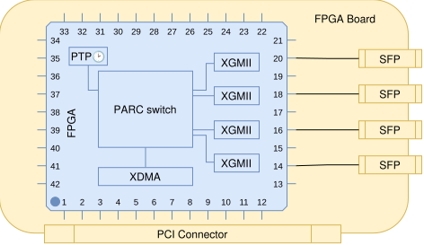

# Saline TSN Switch

Saline is a 4 x 10 Gbps TSN switch, implemented on an AMD/Xilinx
Kintex Ultrascale+ FPGA, using an [ALINX][alinx] [AXKU15][axku15]
PCI-e development board.  The switch core is provided by [Packet
Architects][parc] (PARC).  A 1 Gbps AXI Stream connection to the CPU
is available via AMD/Xilinx's XDMA engine (PG195).  Four SFP+ cages
provide external connectivity, supporting any 10GBASE-R compliant
transceiver, backed by Ethernet MACs from AMD/Xilinx's PG210.


*Figure 1: Saline hardware, FPGA board + PARC switch IP block*


## Getting Started

### Host System Requirements

In order for Infix to manage a Saline board, the host system to which
the board is connected must meet a basic set of requirements:
- The system must run a Linux-based OS. Ubuntu 26.04 is known to work.
- An IOMMU must be available, that provides PCI passthrough
  support. Both AMD-Vi and Intel VT-d are supported by Linux, but
  **only Intel VT-d has been tested** together with Saline.

### Preparing the Board

Infix does not have the ability to load the FPGA bitstream to the
board, it assumes that the device has already been programmed. This
can be done in one of two ways:

1. **Persistently**, by programming the bitstream to the SPI FLASH on
   the development board, via the JTAG port, using the `.mcs` files
   from PARC.  The device will load this configuration on every reset
   thereafter.

2. **Ephemerally**, by loading the bitstream directly to the FPGA's
   volatile memory over the JTAG port, using the `.bit` files from
   PARC.  The device will hold the configuration until the next
   reset. **This approach is not recommended**: several systems are
   known to crash when this kind of online programming is performed.

Either way, AMD/Xilinx's Vivado software needs to be installed to
perform the programming.

### Preparing the System

To make use of PCI passthrough, the OS must be configured to bind
Saline boards to Linux's `vfio` driver. This is typically managed via
`udev` rules, for which a rule is provided that can be installed by
running the following command (`sudo` is most likely required since
files will be installed to system directories):

```bash
~/infix$ sudo make sailfish-saline-install-udev
```

To access the board as your user, the VFIO device will have to be
owned by some group that you are a member of. On debian-based systems,
like Ubuntu, the recommendation is to install a `udev` rule that sets
the group of VFIO devices to `kvm`, which your user should already be
a member of to enable the use of `make run`.

Run the following command to verify that your system is properly
setup:

```bash
~/infix$ sudo make sailfish-saline-check
```

Once all checks pass, you are ready to build and run Infix.


## Usage

### Building

Configure an `x86_64` build with support for Saline, and start the
build:

```bash
~/infix$ make x86_64_minimal_defconfig apply-saline
~/infix$ make
```

Expect the build to take anywhere from 30 minutes to several hours to
complete depending on system performance and Internet connection.

### Running

For the simple case when only a single Saline board is connected to
the host, launch an instance of Infix, connected to that board with:

```bash
~/infix$ make sailfish-saline-run
```

If multiple boards are connected, select the one you want by
specifying its address in the `SALINE` variable:

```bash
~/infix$ make SALINE=0000:02:00.0 sailfish-saline-run
```

[alinx]: https://www.en.alinx.com/
[axku15]: https://www.en.alinx.com/Product/FPGA-Development-Boards/Kintex-UltraScale-plus/AXKU15.html
[parc]:  https://www.packetarchitects.com/
