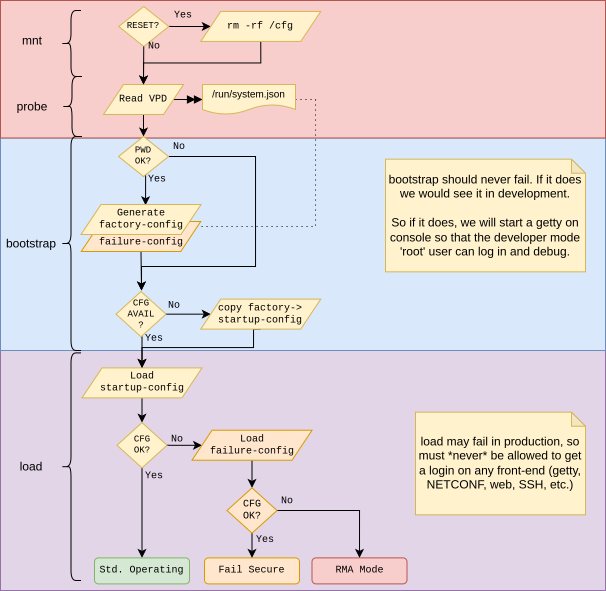

# Boot Procedure

Systems running Infix will typically boot in multiple phases, forming
a boot chain. Each link in the chain has three main responsibilities:

1. Ensuring the integrity of the next link before passing control to
   it. This avoids silent failures stemming from data corruption.
1. Ensuring the authenticity of the next link before passing control
   to it, commonly referred to as _Secure Boot_. This protects against
   malicious attempts to modify a system's firmware.
1. Preparing the system state according to the requirements of the
   next link. E.g. the Linux kernel requires the system's RAM to be
   operational.

A typical chain consists of four stages:

```
    .---------.
    |   ROM   >---.   Determine the location of and load the SPL
    '---------'   |
.-----------------'
|   .---------.
'--->   SPL   >---.   Perform DDR training and load the TPL
    '---------'   |
.-----------------'
|   .---------.
'--->   TPL   >---.   Load Linux kernel, device tree, and root filesystem
    '---------'   |
.-----------------'
|   .---------.
'--->  Infix  |       Get down to business
    '---------'
```

After a reset, hardware will pass control to a program (_ROM_) which
is almost always programmed into the SoC by the vendor.  This program
will determine the location of the _Secondary Program Loader_ (_SPL_),
typically by reading a set of _Sample at Reset_ (SaR) pins.

The _SPL_ is sometimes provided by the SoC vendor in binary form, and
is sometimes built as a part of the _Tertiary Program Loader_ (_TPL_)
build.  Its main responsibility is usually to set up the system's
memory controller and perform DDR training, if required, before
loading the _TPL_.

Commonly referred to as the system's _bootloader_, the _TPL_ is
responsible for preparing the execution environment required by the
Linux kernel.

This document's focus is to describe the final two phases of the boot
chain, as the initial phases are very hardware dependent, better
described by existing documentation provided by the SoC vendor.

## Bootloader

### Configuration

To mitigate the risk of a malicious user being able to circumvent the
bootloader's validation procedure, user configuration is kept to a
minimum.  Two settings are available:

**Boot order**: Since Infix maintains two copies of its software image,
and as both bootloaders support [netbooting][2], the order in which boot
sources are considered can be configured. To select the active
source, use [RAUC][]:

```
root@example:~# rauc status mark-active <slot>
...
```

Where `<slot>` is one of:

| **`<slot>`** | **Source**                |
|--------------|---------------------------|
| `rootfs.0`   | Primary image             |
| `rootfs.1`   | Secondary image           |
| `net.0`      | Netboot (where supported) |

On U-Boot systems the primary and secondary images are stored in disk
partitions, on Barebox systems they are logical volumes, see [Image
Formats](#image-formats).

**Debug**: By default, the kernel will only output errors to the
console during boot. Optionally, this can be altered such that all
enabled messages are logged.

On systems using _U-Boot_, this can be enabled by running `fw_setenv
DEBUG 1`. To restore the default behavior, run `fw_setenv DEBUG`.

On systems using _Barebox_, the kernel command line is part of the
signed boot entry in the image, so this setting is not available.

### U-Boot

Used on _aarch64_ based systems.  It is able to verify both the
_integrity_ and _authenticity_ of an Infix image.  As such, it can be
used as a part of a _Secure Boot_ chain, given that the preceding
links are able to do the same.

Supports booting Infix from a block device using the [ITB Disk
Image](#itb-disk-image) layout. Currently, Virtio and MMC disks are
supported.

An [FIT Framed Squash Image](#fit-framed-squash-image) can be used to
boot Infix over the network.  DHCP is used to configure the network
and TFTP to transfer the image to the system's RAM.

Access to U-Boot's shell is disabled to prevent side-loading of
malicious software.  To configure the active boot partition, refer to
the [Bootloader Configuration](#configuration) section.

### Barebox

Used on _x86_64_ based systems, where it is started by the system's
UEFI firmware from the [EFI System Partition](#esp-esp-backup-efi-system-partitions).
It boots Infix from a [Discoverable Disk Image](#discoverable-disk-image-ddi)
(DDI), either from one of the logical volumes of the [DDI Disk
Image](#ddi-disk-image), or over the network.

When UEFI _Secure Boot_ is enabled, Barebox verifies both the
_integrity_ and _authenticity_ of the Infix image before booting it:

1. The UEFI firmware only starts Barebox if its signature can be
   validated by a certificate in the firmware's signature database
   (`db`).
1. Barebox validates the signature of the DDI's dm-verity root hash
   against the same database.  The root hash, in turn, protects every
   block of the root filesystem.
1. Barebox validates the signature of the Linux kernel, which carries
   its initramfs, before starting it.

Once Linux is running, the initramfs sets up the dm-verity protected
root filesystem using the root hash passed on by Barebox, such that
any modification of the image is detected when the affected blocks
are read.

With _Secure Boot_ disabled, e.g., in virtualized instances without
enrolled keys, the same images are booted but none of the signatures
are required to be valid.

The boot order is managed by Barebox' _bootchooser_, using a set of
priorities and remaining boot attempts for each target, stored in the
[`barebox-state`](#barebox-state-bootloader-state) partition.  Each
boot of an image consumes one attempt, and once Infix has successfully
loaded its `startup-config` the image is marked as good, which resets
its attempts to three.  An image that fails to boot three times in a
row is skipped in favor of the next one in order.  To configure the
active image, refer to the [Bootloader Configuration](#configuration)
section.

When netbooting, Barebox uses DHCP to configure the network and TFTP
to fetch the DDI named in the DHCP bootfile option.  The image is
booted from RAM, using the same validation as when booting from disk.

## System Boot

After the system firmware and [boot loader](#bootloader) start Linux
the following happens.  The various failure modes, e.g., missing
password in VPD, are detailed later in this section.



1. Before mounting `/cfg` and `/var` partitions, hosting read-writable
   data like `startup-config` and container images, the system first
   checks if a factory reset has been requested by the user, if so it
   wipes the contents of these partitions
1. Linux boots with a device tree which is used for detecting generic
   make and model of the device, e.g., number of interfaces.  It may
   also reference an EEPROM with [Vital Product Data](vpd.md).  That is
   where the base MAC address and per-device password hash is stored.
   (Generic builds use the same MAC address and password)
1. On every boot the system's `factory-config` and `failure-config` are
   generated from the YANG[^2] models of the current firmware version.
   This ensures that a factory reset device can always boot, and that
   there is a working fail safe, or rather *fail secure*, mode
1. On first power-on, and after a factory reset, the system does not
   have a `startup-config`, in which case `factory-config` is copied
   to `startup-config` -- if a per-product specific version exists it
   is preferred over the generated one
1. Provided the integrity of the `startup-config` is OK, a system
   service loads and activates the configuration

### Failure Modes

So, what happens if any of the steps above fail?

#### VPD Fail

The per-device password cannot be read, or is corrupt, so the system
`factory-config` and `failure-config` are not generated:

1. First boot, or after factory reset: `startup-config` cannot be
   created or loaded, and `failure-config` cannot be loaded.  The
   system ends up in an unrecoverable state, i.e., **RMA[^3] Mode**
1. The system has booted (at least) once with correct VPD and password
   and already has a `startup-config`.  Provided the `startup-config`
   is OK (see below), it is loaded and system boots successfully

In both cases, external factory reset modes/button will not help, and
in the second case will cause the device to fail on the next boot.

> [!NOTE]
> The second case does not yet have any warning or event that can be
> detected from the outside.  This is planned for a later release.

#### Broken startup-config

If loading `startup-config` fails for some reason, e.g., invalid JSON
syntax, a failed [migration](upgrade.md#configuration-migration) or
validation against the system's YANG model, or a bug in the system's
`confd` service, *Fail Secure Mode* is triggered and `failure-config` is
loaded (unless VPD Failure, see above).  The system then marks the boot
as failed and resets, so that the next boot starts from a clean state
and goes straight to *Fail Secure Mode*.  The mark is cleared on that
boot, so a reboot after it tries `startup-config` again.

The same happens if loading `startup-config` hangs, e.g., a service that
never responds.  The system watchdog then resets the unit, by default
after 70 seconds, and the next boot goes straight to *Fail Secure
Mode*.

> [!TIP]
> Please see the [Branding & Releases](branding.md) document for how to
> provide per-product `failure-config`, or `factory-config` to suit your
> product's preferences.

*Fail Secure Mode* is a fail-safe mode provided for debugging the
system.  The default[^4] creates a setup of isolated interfaces with
communication only to the management CPU, SSH and console login using
the device's factory reset password, IP connectivity only using IPv6
link-local, and device discovery protocols: LLDP, mDNS-SD.  The login
and shell prompt are set to `failure-c0-ff-ee`, the last three octets of
the device's base MAC address.

## System Upgrade

Much of the minutiae of software upgrades is delegated to [RAUC][],
which offers lots of benefits out-of-the-box:

- Upgrade Bundles are always signed, such that their authenticity can
  be verified by the running operating system, before the new one is
  installed.
- The bureaucracy of interfacing with different bootloaders, manage
  the boot order, is a simple matter of providing a compatible
  configuration.
- Updates can be sourced from the local filesystem (including external
  media like USB sticks or SD-cards) and from remote servers using FTP
  or HTTP(S).

To initiate a system upgrade from the shell[^1], run:

```
root@example:~# rauc install <file|url>
...
```

Where the file or URL points to a RAUC Upgrade Bundle, i.e., a [DDI
RAUC Upgrade Bundle](#ddi-rauc-upgrade-bundle) or an [ITB RAUC Upgrade
Bundle](#itb-rauc-upgrade-bundle), depending on the system.

This will upgrade the image not currently running.  After a
successful upgrade is completed, you can reboot your system, which
will then boot from the newly installed image.  Since the image from
which you were originally running is now inactive, running the same
upgrade command again will bring both images into sync.

## Image Formats

Infix is built in one of two families of image formats, depending on
the bootloader used by the target:

- **DDI based**: used with [Barebox](#barebox), currently on _x86_64_.
  The root filesystem is distributed as a [Discoverable Disk
  Image](#discoverable-disk-image-ddi), and the system disk is managed
  using LVM.
- **ITB based**: used with [U-Boot](#u-boot), on _aarch64_.  The root
  filesystem is distributed as a [FIT Framed Squash
  Image](#fit-framed-squash-image), and the system disk uses a fixed
  partition layout.

Common to both is the [SquashFS Image](#squashfs-image), which holds
Infix's Linux kernel and root filesystem.

In the names below, `${ARTIFACT}` is the image name of the build,
e.g. `infix-x86_64`, with the release version appended for release
builds.

### SquashFS Image

**Canonical Name**: `rootfs.squashfs`

The central read-only filesystem image containing Infix's Linux
kernel, device trees, and root filesystem. All other images bundle
this image, or is dependent on it, in one way or another.

On ITB based systems, it can be used on its own as an [initrd][] to
efficiently boot a virtual instance of Infix.

### DDI Based Images

#### Discoverable Disk Image (DDI)

**Canonical Name**: `${ARTIFACT}.raw`

A GPT partitioned image following the [Discoverable Disk Image][DDI]
specification, holding three partitions:

| **Partition**     | **Contents**                                         |
|-------------------|------------------------------------------------------|
| `root`            | The [SquashFS Image](#squashfs-image)                |
| `root-verity`     | The dm-verity hash tree of the SquashFS image        |
| `root-verity-sig` | A signature of the hash tree's root hash, as JSON    |

The partition type UUIDs follow the [Discoverable Partitions][DPS]
specification, so that the partitions can be located without any
external metadata.  The partition UUIDs of `root` and `root-verity`
are derived from the root hash itself, which lets the bootloader and
the initramfs find the partitions belonging to a particular root hash.

Since the signature covers the root hash, and the root hash covers
every block of the root filesystem, a single signature check is enough
to establish trust in the entire image.

The DDI is the unit that is installed on the system disk, carried in
the [DDI RAUC Upgrade Bundle](#ddi-rauc-upgrade-bundle), and used to
[netboot](#barebox) the system.

#### DDI RAUC Upgrade Bundle

**Canonical Name**: `${ARTIFACT}.pkg`

A signed, verity formatted, [RAUC][] bundle containing the
[DDI](#discoverable-disk-image-ddi).  On installation, the logical
volume of the inactive image is resized to fit the new DDI, which is
then written to it.

When performing a [System Upgrade](#system-upgrade), this is the format
to use.

#### DDI Disk Image

**Canonical Names**: `${ARTIFACT}.disk`, `${ARTIFACT}.qcow2`

A full system image, used to provision a new system, either by writing
`.disk` to its block device or by using `.qcow2` as the disk of a
virtual machine.  The disk uses the GPT partitioning scheme:

```
.--------------.
|  GPT Table   |
:--------------:
|     esp      |
:--------------:
|  esp-backup  |
:--------------:
| barebox-state|
:--------------:
|              |
|   internal   |
|              |
'--------------'
```

##### `esp`, `esp-backup` - EFI System Partitions

| **Parameter** | **Value**        |
|---------------|------------------|
| Required      | Yes              |
| Size          | 16 MiB           |
| Format        | VFAT filesystem  |

Holds the signed Barebox EFI binary, started by the UEFI firmware, as
well as marker files shared between Infix and its bootloader, e.g., a
pending factory reset.  The partitions are mounted at `/boot/efi` and
`/boot/efi-backup`, respectively.

##### `barebox-state` - Bootloader State

| **Parameter** | **Value**              |
|---------------|------------------------|
| Required      | Yes                    |
| Size          | 2 KiB                  |
| Format        | Raw Barebox state data |

Holds the bootchooser's priority and remaining boot attempts of each
boot target.  Infix manages it through [RAUC][], see [Bootloader
Configuration](#configuration).

##### `internal` - Internal Volume Group

| **Parameter** | **Value**            |
|---------------|----------------------|
| Required      | Yes                  |
| Size          | Rest of the disk     |
| Format        | LVM2 physical volume |

An LVM physical volume, belonging to the volume group `internal`,
holding the following logical volumes:

| **Volume**  | **Contents**                                           |
|-------------|--------------------------------------------------------|
| `primary`   | A [DDI](#discoverable-disk-image-ddi)                  |
| `secondary` | A [DDI](#discoverable-disk-image-ddi)                  |
| `rw`        | BTRFS filesystem holding all persistent data           |

Two copies of the system image exist so that an incomplete upgrade
does not brick the system, and to allow fast rollbacks when upgrading
to a new version.

The `rw` volume holds one BTRFS subvolume each for `/cfg`, `/var`,
`/root`, and `/home`.  If it cannot be mounted, Infix falls back to
temporary storage in RAM for all of them, and the system will not
retain any changes across reboots.

To keep the distributed image small, it only contains the `primary`
volume.  On the first boot, the system:

1. Grows the `internal` partition, and its physical volume, to cover
   the entire disk.
1. Creates the `secondary` volume as a copy of `primary`, provided
   there is enough free space.
1. Creates the `rw` volume, using half of the remaining free space,
   leaving the rest for future growth of the system images.

A [factory reset](#system-boot) removes the `rw` volume, which is then
recreated, empty, during the following boot.

### ITB Based Images

#### FIT Framed Squash Image

**Canonical Name**: `rootfs.itb`

As the name suggests, this is essentially the [Squash FS
Image](#squashfs-image) with a _Flattened Image Tree_ ([FIT][])
header.  Being a native format to U-Boot, using this framing allows us
to verify the integrity and authenticity of the SquashFS image using
standard U-Boot primitives.

In contrast to most FIT images, the kernel and device trees are not
stored as separate binaries in the image tree.  Instead, Infix follows
the standard Linux layout where the kernel and related files are
stored in the `/boot` directory of the filesystem.

On disk, this image is then stored broken up into its two components;
the _FIT header_ (`rootfs.itbh`) and the SquashFS image.  The header
is stored on the [Auxiliary Data](#aux-auxiliary-data) partition of
the [ITB Disk Image](#itb-disk-image), while the SquashFS image is
stored in one of the [Root
Filesystem](#primary-secondary-root-filesystems) partitions.

When the system boots, U-Boot will concatenate the two parts to
validate the SquashFS's contents. This path was chosen because:

- Having a separate raw SquashFS means Linux can directly mount it as
  the root filesystem.

- It decouples Infix from U-Boot.  If a better way of validating our
  image is introduced, we can switch to it without major changes to
  Infix's boot process, as we can still use a regular SquashFS as the
  root filesystem.

- It lets us use standard interfaces to boot Linux, like SYSLINUX.  It
  also plays well with traditional bootloaders.

In its full form, it can be used to netboot Infix, as it contains all
the information needed by U-Boot in a single file.

#### ITB RAUC Upgrade Bundle

**Canonical Name**: `${ARTIFACT}.pkg`

Itself a SquashFS image, this bundle (sometimes referred to package)
contains the Infix [SquashFS Image](#squashfs-image) along with the
header of the [FIT Framed Squash Image](#fit-framed-squash-image), and
some supporting files to let [RAUC][] know how install it on the target
system.

When performing a [System Upgrade](#system-upgrade), this is the format
to use.

#### ITB Disk Image

**Canonical Name**: `disk.img`

Infix runs from a block device (e.g. eMMC or virtio disk) with the
following layout. The disk is expected to use the GPT partitioning
scheme. Partitions marked with an asterisk are optional.

```
.-----------.
| GPT Table |
:-----------:
|    boot*  |
:-----------:
|    aux    |
:-----------:
|           |
|  primary  |
|           |
:-----------:
|           |
| secondary |
|           |
:-----------:
|    cfg    |
:-----------:
|           |
|    var*   |
|           |
'-----------'
```

##### `boot` - Bootloader

| **Parameter** | **Value**                               |
|---------------|-----------------------------------------|
| Required      | No                                      |
| Size          | 4 MiB                                   |
| Format        | Raw binary, as dictated by the hardware |

Optional partition containing the system's bootloader. May also reside
in a separate storage device, e.g. a serial FLASH.

##### `aux` - Auxiliary Data

| **Parameter** | **Value**       |
|---------------|-----------------|
| Required      | Yes             |
| Size          | 4 MiB           |
| Format        | EXT4 filesystem |

Holds information that is shared between Infix and its bootloader,
such as image signatures required to validate the chain of trust,
bootloader configuration etc.

Typical layout when using U-Boot bootloader:

```
/
├ primary.itbh
├ secondary.itbh
└ uboot.env
```

During boot, an ITB header along with the corresponding root
filesystem image are concatenated in memory, by U-Boot, to form a
valid FIT image that is used to verify its integrity and origin before
any files are extracted from it.

Note that the bootloader's primary environment is bundled in the
binary - `uboot.env` is only used to import a few settings that is
required to configure the boot order.

##### `primary`, `secondary` - Root Filesystems

| **Parameter** | **Value**         |
|---------------|-------------------|
| Required      | Yes               |
| Size          | >= 256 MiB        |
| Format        | Squash filesystem |

Holds the [SquashFS Image](#squashfs-image). Two copies exist so that
an incomplete upgrade does not brick the system, and to allow fast
rollbacks when upgrading to a new version.

##### `cfg` - Configuration Data

| **Parameter** | **Value**       |
|---------------|-----------------|
| Required      | Yes             |
| Size          | >= 16 MiB       |
| Format        | EXT4 filesystem |

Non-volatile storage of the system configuration and user data.
Concretely, user data is everything stored under `/root` and `/home`.

##### `var` - Variable Data

| **Parameter** | **Value**       |
|---------------|-----------------|
| Required      | No              |
| Size          | >= 16 MiB       |
| Format        | EXT4 filesystem |

Persistent storage for everything under `/var`. This is maintained as
a separate filesystem from the data in `cfg`, because while the system
can funtion reasonably well without a persistent `/var`, loosing
`/cfg` or `/etc` is much more difficult.

If `var` is not available, Infix will still persist `/var/lib` using
`cfg` as the backing storage.

[^1]: See [Upgrade & Boot Order](upgrade.md) for more information.
[^2]: YANG is a modeling language from IETF, replacing that used for
    SNMP (MIB), used to describe the subsystems and properties of
    the system.
[^3]: Return Merchandise Authorization (RMA), i.e., broken beyond repair
    by end-user and eligible for return to manufacturer.
[^4]: Customer specific builds can define their own `failure-config`.
    It may be the same as `factory-config`, with the hostname set to
    `failure`, or a dedicated configuration that isolates interfaces, or
    even disables ports, to ensure that the device does not cause any
    security problems on the network.  E.g., start forwarding traffic
    between previously isolated VLANs.

[2]:      netboot.md
[DDI]:    https://uapi-group.org/specifications/specs/discoverable_disk_image/
[DPS]:    https://uapi-group.org/specifications/specs/discoverable_partitions_specification/
[FIT]:    https://u-boot.readthedocs.io/en/latest/usage/fit.html
[RAUC]:   https://rauc.io
[initrd]: https://docs.kernel.org/admin-guide/initrd.html
