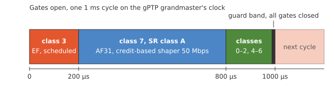
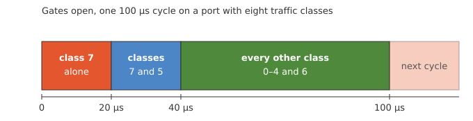
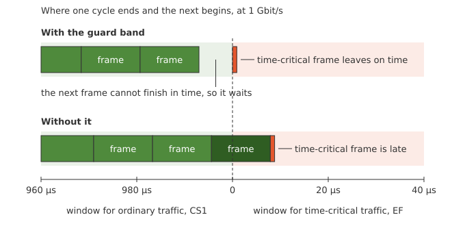

Time-Sensitive Networking
=========================

Priorities decide who goes first on a busy port, see [Quality of
Service](qos.md).  Some traffic needs more than that: a stream that
must get its bandwidth whatever else is sent, or a control loop that
must hear from its sensor every millisecond and cannot wait behind a
frame that happened to start just before.  Time-Sensitive Networking
(TSN) is the set of IEEE 802.1 standards for such traffic.  Three of
them work together on a port:

| Building block      | Standard     | What it does                                             |
|---------------------|--------------|----------------------------------------------------------|
| Synchronised time   | IEEE 802.1AS | Gives every switch and station the same clock, see [PTP](ptp.md) |
| Credit-based shaper | IEEE 802.1Qav | Holds a traffic class to a reserved rate                |
| Time-aware shaper   | IEEE 802.1Qbv | Opens each traffic class's gate by a repeating timetable |
/// table-caption
The building blocks of TSN on a port.
///

The two shapers are available on products built with TSN support.
Where they are not, the `cbsa` and `gate-parameter-table` settings do
not exist.  Whether a port's switch hardware runs them is listed in its
`qos capabilities`, see [Hardware Offload](qos.md#hardware-offload).
The shapers act on traffic classes, so the port's classification and
class table come first, see [Quality of Service](qos.md).

## Setting Up a Scheduled Port

One port, `e2`, carries three kinds of traffic toward a machine cell:
control traffic that must arrive within a fixed part of every
millisecond, a video stream that needs 50 Mbps, and everything else.

{ width=600 }
/// figure-caption
The timetable of the example, one 1 ms cycle.
///

First the clock.  The device is the gPTP grandmaster on the port, and
the stations follow it:

<pre class="cli"><code>admin@example:/config/> <b>edit ptp instance 0</b>
admin@example:/config/ptp/instance/0/> <b>set default-ds profile ieee802-dot1as</b>
admin@example:/config/ptp/instance/0/> <b>set default-ds domain-number 0</b>
admin@example:/config/ptp/instance/0/> <b>set default-ds priority1 1</b>
admin@example:/config/ptp/instance/0/> <b>edit port 1</b>
admin@example:/config/ptp/…/0/port/1/> <b>set underlying-interface e2</b>
admin@example:/config/ptp/…/0/port/1/> <b>leave</b>
</code></pre>

Then the traffic classes.  The `ieee-sr` preset is the layout IEEE
802.1Q recommends for a port with reserved streams: the video stream,
priority 3, goes to class 7, and the control traffic, priority 5, to
class 3.  Class 7 gets a reservation of 50 Mbps:

<pre class="cli"><code>admin@example:/config/> <b>edit interface e2</b>
admin@example:/config/interface/e2/> <b>set qos egress traffic-class-table preset ieee-sr</b>
admin@example:/config/interface/e2/> <b>set qos egress traffic-class 7 algorithm credit-based-shaper</b>
admin@example:/config/interface/e2/> <b>set cbsa-parameter-table 7 admin-idle-slope 50M</b>
</code></pre>

Last the timetable: 200 µs for class 3, 600 µs for class 7, the rest
of the cycle for the other classes, and a guard band of 12.3 µs with
all gates closed before the cycle starts over.

<pre class="cli"><code>admin@example:/config/interface/e2/> <b>edit gate-parameter-table</b>
admin@example:/config/interface/…/gate-parameter-table/> <b>set gate-enabled true</b>
admin@example:/config/interface/…/gate-parameter-table/> <b>set admin-cycle-time numerator 1 denominator 1000</b>
admin@example:/config/interface/…/gate-parameter-table/> <b>set gate-control-entry 0 operation-name set-gate-states gate-states-value 8 time-interval-value 200000</b>
admin@example:/config/interface/…/gate-parameter-table/> <b>set gate-control-entry 1 operation-name set-gate-states gate-states-value 128 time-interval-value 600000</b>
admin@example:/config/interface/…/gate-parameter-table/> <b>set gate-control-entry 2 operation-name set-gate-states gate-states-value 119 time-interval-value 187700</b>
admin@example:/config/interface/…/gate-parameter-table/> <b>set gate-control-entry 3 operation-name set-gate-states gate-states-value 0 time-interval-value 12300</b>
admin@example:/config/interface/…/gate-parameter-table/> <b>leave</b>
</code></pre>

The port where the traffic enters decides which frames get priority 5
and 3, e.g. by trusting the DSCP, see [Ingress
Classification](qos.md#ingress-classification).  The sections below
describe each shaper, and [Measuring the Result](#measuring-the-result)
how to check the timing on the wire.

## Credit-Based Shaper

A traffic class can reserve bandwidth with the IEEE 802.1Qav
credit-based shaper.  The shaper runs in the switch fabric where the
hardware has one, see [Hardware Offload](qos.md#hardware-offload); elsewhere
the kernel runs it for the traffic it forwards itself.  Turning it on
takes two settings in two places, as the standard splits them: the
class's `algorithm` under `qos egress`, and the reservation as
`admin-idle-slope`, in bits per second, here 20M for 20000000, in
`cbsa-parameter-table` beside `qos` on the interface, i.e.
`/interfaces/interface[name='e1']/cbsa/cbsa-parameter-table[traffic-class='7']/`.
One without the other is rejected.

Reserve 20 Mbps for class 7 on a port:

<pre class="cli"><code>admin@example:/config/> <b>edit interface e1</b>
admin@example:/config/interface/e1/> <b>set qos egress traffic-class 7 algorithm credit-based-shaper</b>
admin@example:/config/interface/e1/> <b>set cbsa-parameter-table 7 admin-idle-slope 20M</b>
admin@example:/config/interface/e1/> <b>leave</b>
</code></pre>

The class sends at most its reservation on average, and credit earned
while it waits lets it burst by about one frame.  Shaped classes must
be the highest-numbered ones, above the strict classes, as IEEE
802.1Q-2022 34.5 lays a port out, and the reservation may not exceed
the link rate.  A port with an `egress-shaper` cannot shape per class.
The reservation in force is reported as `oper-idle-slope`.

## Time-Aware Shaper

A port can run the IEEE 802.1Qbv time-aware shaper: a repeating cycle
in which each traffic class's gate is open only in defined windows, so
a reserved window stays quiet whatever else is queued.  The gates run
in the switch fabric where the hardware has one, see [Hardware
Offload](qos.md#hardware-offload), and the schedule needs synchronised time
across the network, see [PTP](ptp.md).

The gate control list lives in `gate-parameter-table` beside `qos` on
the interface, `/interfaces/interface[name='e1']/gate-parameter-table/`,
one `gate-control-entry` per step.  Each entry opens the
gates in `gate-states-value`, a bit per traffic class with bit 0 for
class 0, for `time-interval-value` nanoseconds.  `admin-cycle-time` is
a fraction of a second, unset it is the sum of the entries, and
`admin-base-time` anchors the cycle to the clock.  A 100 µs cycle with
class 7 alone for 20 µs, classes 7 and 5 for 20 µs, and the rest for
60 µs:

{ width=600 }
/// figure-caption
The gate control list of the example.
///

The mask of an entry is the sum of the values of the classes it opens:

| Class | 7   | 6  | 5  | 4  | 3 | 2 | 1 | 0 | `gate-states-value` |
|-------|----:|---:|---:|---:|--:|--:|--:|--:|--------------------:|
| Value | 128 | 64 | 32 | 16 | 8 | 4 | 2 | 1 |                     |
| Entry 0, class 7 alone   | 128 |    |    |    |   |   |   |   | 128 |
| Entry 1, classes 7 and 5 | 128 |    | 32 |    |   |   |   |   | 160 |
| Entry 2, the rest        |     | 64 |    | 16 | 8 | 4 | 2 | 1 |  95 |
/// table-caption
The gate masks of the example, 255 opens every gate and 0 closes them all.
///

<pre class="cli"><code>admin@example:/config/> <b>edit interface e1 gate-parameter-table</b>
admin@example:/config/interface/…/gate-parameter-table/> <b>set gate-enabled true</b>
admin@example:/config/interface/…/gate-parameter-table/> <b>set admin-cycle-time numerator 1 denominator 10000</b>
admin@example:/config/interface/…/gate-parameter-table/> <b>set admin-base-time seconds 0 nanoseconds 200</b>
admin@example:/config/interface/…/gate-parameter-table/> <b>set gate-control-entry 0 operation-name set-gate-states gate-states-value 128 time-interval-value 20000</b>
admin@example:/config/interface/…/gate-parameter-table/> <b>set gate-control-entry 1 operation-name set-gate-states gate-states-value 160 time-interval-value 20000</b>
admin@example:/config/interface/…/gate-parameter-table/> <b>set gate-control-entry 2 operation-name set-gate-states gate-states-value 95 time-interval-value 60000</b>
admin@example:/config/interface/…/gate-parameter-table/> <b>leave</b>
</code></pre>

The list applies at commit.  Gated classes are served strictly, so a
gated port rejects weighted classes, and the schedule takes the whole
port, so it rejects an `egress-shaper` as well.  A shaped class under gates
keeps its reservation: credit is earned only while its gate is open,
and the shaper is set up with the slope raised by the cycle over the
class's open time, as 802.1Q-2022 8.6.8.2 specifies.  A shaped class
whose gate never opens is rejected.  The list, cycle and base time the
port runs are reported as `oper-control-list`, `oper-cycle-time` and
`oper-base-time`.

A frame that cannot finish before its gate closes waits for the next
opening, as 802.1Q-2022 8.6.8.4 requires, so no window overruns into
the next.  A switch does this by closing each gate a guard band early,
long enough for the largest frame.

{ width=560 }
/// figure-caption
A full-size frame at the end of a window, with and without the guard band.
///

`queue-max-sdu-table` sets the
largest frame of a class, in bytes counted like the MTU.  Longer frames
of the class are dropped, and a switch that sizes its guard bands from
it leaves more of a short window to a class of small frames.  For
class 7, carrying 200-byte frames:

<pre class="cli"><code>admin@example:/config/> <b>edit interface e1 gate-parameter-table</b>
admin@example:/config/interface/…/gate-parameter-table/> <b>set queue-max-sdu-table 7 queue-max-sdu 200</b>
admin@example:/config/interface/…/gate-parameter-table/> <b>leave</b>
</code></pre>

A schedule meant to hold also on bridges that let a frame overrun its
window adds a guard band of its own: an entry with all gates closed
before the protected window, as long as the largest frame takes on the
wire.  That is 12.3 µs at 1 Gbps for a 1500-byte frame with one VLAN
tag, and 123 µs at 100 Mbps.  A switch that holds frames back itself
may use a longer band than the list does, see the limits of each
family under [Hardware Offload](qos.md#hardware-offload).

## Measuring the Result

The list, cycle and base time a port runs are in the operational
datastore, as described above, together with `oper-idle-slope` for
each shaped class.  That shows what is configured.  Whether frames
leave when the timetable says takes a measurement, and the system
comes with a tool for it: `ptping` sends probes that are timestamped
in hardware, both when they leave the sender and when they reach the
receiver.  With all clocks synchronised, each probe shows how long it
took and where in the cycle it arrived.

The probes are PTP messages over UDP, in a PTP domain of their own,
254 unless another is given.  The clocks must be synchronised with PTP
over Layer 2, as gPTP is.  Start a sink on the station at the far end:

<pre class="cli"><code>admin@listener:~$ <b>sudo ptping sink</b>
</code></pre>

Check from the sending station that the sink answers and that both
ends can timestamp:

<pre class="cli"><code>admin@talker:~$ <b>sudo ptping probe 192.168.20.2</b>
</code></pre>

Then send probes marked EF, DSCP 46, against a 1 ms cycle.  With an
interval of 1.003 ms between them, the probes reach the port under
test a little later in the cycle each time, and after 333 they have
covered all of it.  With `--observe` the probes are sent throughout
the cycle, and `stat` prints a running summary with one row for those
that left inside the window given, here the first 200 µs, and one for
those outside it:

<pre class="cli"><code>admin@talker:~$ <b>sudo ptping stat --cycle 1ms --window 0+200us --observe -r 1.003ms -c 999 -n control -d 46 192.168.20.2</b>
</code></pre>

A probe that reaches a closed gate waits for it, so its latency grows
by the time left until the gate opens.  `record` saves every probe as
a line of CSV instead, with the time it left and arrived and where in
the cycle that was, for a closer look.
