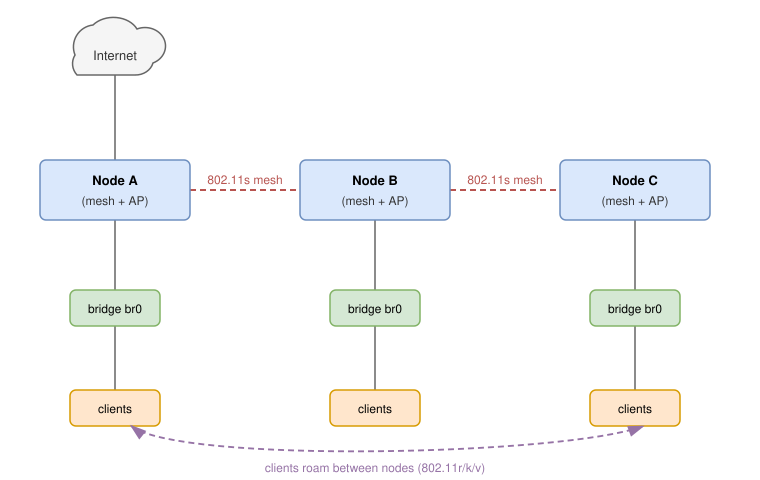

# Wi-Fi (Wireless LAN)

Infix supports Wi-Fi as a client (Station), as an Access Point, as an
802.11s mesh point, and as a 4-address (WDS) link for wireless bridges
and repeaters.  When a compatible Wi-Fi adapter is detected, the system
automatically creates a WiFi radio (PHY) in factory-config, that can
host virtual interfaces.

## Architecture Overview

Infix uses a two-layer WiFi architecture:

1. **WiFi Radio (PHY layer)**: Represents the physical wireless hardware
     - Configured via `ietf-hardware` module
     - Controls channel, transmit power, regulatory domain
     - One radio can host multiple virtual interfaces

2. **WiFi Interface (Network layer)**: Virtual interface on a radio
     - Configured via `infix-interfaces` module
     - Operates in Station (client), Access Point, Mesh Point or WDS link mode
     - Each interface references a parent radio

## Naming Conventions

Like other interface types in Infix, WiFi components follow naming conventions
that allow the CLI to automatically infer types:

| **Name Pattern** | **Type**        | **Description**                          |
|------------------|-----------------|------------------------------------------|
| `radioN`         | WiFi Radio      | Hardware component for WiFi PHY          |
| `wifiN`          | WiFi Interface  | Virtual WiFi interface on a radio        |

Where `N` is a number (0, 1, 2, ...).

> [!TIP]
> Using these naming conventions simplifies configuration since type/class
> settings are automatically inferred.  For example, creating a hardware
> component named `radio0` automatically sets its class to `wifi`, enabling
> the `wifi-radio` configuration container.
>
> **Note:** This inference only works with the CLI.  Configuring WiFi over
> NETCONF or RESTCONF requires setting the class/type explicitly.

## Current Limitations

- USB hotplug is not supported - adapters must be present at boot
- Interface naming may be inconsistent with multiple USB Wi-Fi adapters
- A station and access points on the same radio must share a channel: the
  station follows its access point, so pin the radio to that channel on
  both ends.  See [WDS Backhaul and Repeaters](#wds-backhaul-and-repeaters)

## Supported Wi-Fi Adapters

Wi-Fi support is primarily tested with Realtek chipset-based adapters.

### Known Working Chipsets

- Built-in Wi-Fi on Banana Pi BPi-R3
- Built-in Wi-Fi on Raspberry Pi 4/CM4
- Realtek:
    - RTL8188CU
    - RTL8188FU
    - RTL8821CU

Other Realtek chipsets may work but are not tested.

> [!NOTE]
> Some Realtek chipsets require proprietary drivers not included in the
> standard kernel.
>
> - Firmware requirements vary by chipset
> - Check kernel logs if your adapter is not detected

### USB WiFi Dongles

USB WiFi dongles may be slow to initialize at boot due to firmware
loading. If your USB dongle is not detected reliably, configure a
`probe-timeout` on the radio to wait for the PHY:

<pre class="cli"><code>admin@example:/> <b>configure</b>
admin@example:/config/> <b>edit hardware component radio0 wifi-radio</b>
admin@example:/config/hardware/component/radio0/wifi-radio/> <b>set probe-timeout 30</b>
admin@example:/config/hardware/component/radio0/wifi-radio/> <b>leave</b>
</code></pre>

This waits up to 30 seconds for the radio PHY to appear before creating
WiFi interfaces. If the PHY is not detected within the timeout, a dummy
interface is created as a placeholder, allowing IP configuration to proceed.
Reboot when the radio becomes available.

## Radio Configuration

Before configuring WiFi interfaces, you must first configure the WiFi radio.
Radios are automatically discovered and named `radio0`, `radio1`, etc.

### Country Code ⚠

The country code is one setting for all radios in the system, since the
regulatory domain is one setting in the kernel.  It defaults to "00", the
world domain: no 6 GHz, listen-only on 5 GHz, and no access point or mesh
point can be configured.  Some systems ship with a factory default
(typically "DE" for the BPi-R3).

<pre class="cli"><code>admin@example:/> <b>configure</b>
admin@example:/config/> <b>set hardware wifi country-code DE</b>
admin@example:/config/> <b>leave</b>
</code></pre>

> [!IMPORTANT] Legal notice!
> The country code is **legally required** and determines which WiFi
> channels and power levels are permitted in your location. Using an
> incorrect country code may violate local wireless regulations.

**Common country codes, see [ISO 3166-1 alpha-2][1] for the complete list**:

- Europe:
    - DE: Germany
    - SE: Sweden
    - GB: UK
    - FR: France
    - ES: Spain
- Americas:
    - US: United States
    - CA: Canada
    - BR: Brazil
- Asia-Pacific:
	- JP: Japan
	- AU: Australia
	- CN: China

### Basic Radio Setup

Configure the radio with band and channel.  The country code above covers
all radios.

**For Station (client) mode:**

<pre class="cli"><code>admin@example:/> <b>configure</b>
admin@example:/config/> <b>edit hardware component radio0 wifi-radio</b>
admin@example:/config/hardware/component/radio0/wifi-radio/> <b>leave</b>
</code></pre>

**For Access Point mode:**

<pre class="cli"><code>admin@example:/> <b>configure</b>
admin@example:/config/> <b>edit hardware component radio0 wifi-radio</b>
admin@example:/config/hardware/component/radio0/wifi-radio/> <b>set band 5GHz</b>
admin@example:/config/hardware/component/radio0/wifi-radio/> <b>set channel 36</b>
admin@example:/config/hardware/component/radio0/wifi-radio/> <b>set channel-width 80MHz</b>
admin@example:/config/hardware/component/radio0/wifi-radio/> <b>leave</b>
</code></pre>

**Key radio parameters:**

**⚠ Must match your physical location for legal compliance! ⚠**

- `band`: 2.4GHz, 5GHz, or 6GHz (required for AP mode). Automatically enables
  appropriate WiFi standards:
    - 2.4GHz: 802.11n/ax
    - 5GHz: 802.11n/ac/ax
    - 6GHz: 802.11ax
- `channel`: Channel number (1-233) or "auto".  When set to "auto", defaults to
  channel 6 for 2.4GHz, channel 36 for 5GHz, or channel 37 for 6GHz
- `channel-width`: AP channel bandwidth.  Supported values are `auto`, `20MHz`,
  `40MHz`, `80MHz`, and `160MHz`.  Wider channels require matching hardware,
  regulatory approval, and are only available on 5GHz/6GHz where supported.
- `legacy-rates`: Allow legacy 802.11b rates (1, 2, 5.5, 11 Mbps) on 2.4GHz
  (default: disabled).  Slow 802.11b clients consume excessive airtime and
  degrade throughput for all stations, so the rates are normally suppressed.
  Enable only when old 2.4GHz-only IoT devices need them to associate.  No
  effect on 5GHz/6GHz.
- `probe-timeout`: Seconds to wait for PHY detection at boot (default: 0).  Set
  to a non-zero value (e.g., 30) for USB WiFi dongles that are slow to
  initialize due to firmware loading

> [!NOTE]
> TX power is still determined by the driver based on regulatory
> constraints and hardware capabilities.  Channel width can now be set
> explicitly for AP mode, or left at `auto` to let the driver choose.

### Bands and Channels

Each band strikes a different balance between range and capacity.  The
`country-code` decides which channels are legal in your location; the
lists below are the common allocations, and your regulatory domain may
allow fewer.

**2.4 GHz**

Channels 1-13 are available in most of the world, 1-11 in the US and
Canada, and 14 in Japan (802.11b only).  At 20 MHz only three channels
avoid overlap: 1, 6, and 11.  A 40 MHz channel takes up most of the
band, so it is seldom worth using here.

Drawbacks:

- This is the most crowded band.  It is shared with Bluetooth, Zigbee,
  cordless phones, microwave ovens, and most of the neighboring Wi-Fi.
- Narrow channels and constant contention hold real throughput well
  below 5 and 6 GHz.
- The upside is range: 2.4 GHz reaches further and passes through walls
  better, which keeps it useful for distant clients and 2.4 GHz-only
  IoT devices.

**5 GHz**

UNII-1 (channels 36-48) and UNII-3 (149-165) need no radar checks.
UNII-2 (channels 52-64 and 100-144) shares spectrum with radar and
requires DFS.  ETSI regions such as the EU do not include UNII-3, so the
only non-DFS 5 GHz channels there are 36-48.  This band supports 20, 40,
80, and 160 MHz, so it is the one to use for wide, fast channels.

Drawbacks:

- Shorter range than 2.4 GHz, and a weaker signal through walls and
  floors.
- A DFS channel must be monitored for radar for 60 seconds (up to 10
  minutes near some weather radars) before the AP may transmit, which
  delays start-up.  If radar appears later, the AP has to leave the
  channel within 10 seconds and avoid it for 30 minutes, dropping
  clients during the move.
- The widest 80 and 160 MHz channels almost always sit on DFS spectrum,
  so the same radar rules apply to them.

**6 GHz**

The FCC regions open 59 channels (1, 5, 9 ... 233) across 5925-7125 MHz.
ETSI regions, including the EU, currently open only the lower part,
5945-6425 MHz (channels 1-93), for indoor use.  Clients find networks on
the 15 Preferred Scanning Channels (5, 21, 37 ... 229) spaced every
80 MHz, and `auto` selects channel 37.  There is no DFS in 6 GHz, so
there is no radar start-up delay.

Drawbacks:

- The shortest range and the weakest wall penetration of the three
  bands.
- Only Wi-Fi 6E and newer clients can use it; older phones and IoT
  devices cannot see the band at all.
- AP operation requires WPA3-Personal (SAE) with management frame
  protection, so WPA2-only and open networks are rejected.
- Indoor power limits cap coverage further.

### WiFi 6 Support

WiFi 6 (802.11ax) is always enabled in AP mode on all bands, providing improved
performance through features like OFDMA, BSS Coloring, and beamforming.

**WiFi 6 Features (always enabled in AP mode on supported radios):**

- **OFDMA**: Better multi-user efficiency in dense environments
- **BSS Coloring**: Reduced interference from neighboring networks
- **Beamforming**: Improved signal quality and range

**Requirements:**

- Hardware must support 802.11ax
- Client devices must support WiFi 6 for full benefits
- Older WiFi 5/4 clients can still connect but won't use WiFi 6 features

> [!IMPORTANT]
> 6 GHz AP operation requires WPA3-Personal (SAE) with mandatory
> management frame protection.  Open networks and WPA2-only AP
> configurations are not valid on 6 GHz.

## Discovering Available Networks

Before connecting to a WiFi network you need to know which networks are in
range.  A scan lists them, with signal strength and security, and works on
any radio, whether or not it has an interface yet.  The radio leaves its
channel for a few seconds during the scan, so traffic on it pauses.

<pre class="cli"><code>admin@example:/> <b>show hardware radio0 scan</b>
SSID                  BSSID              SECURITY       SIGNAL   CHANNEL
MyNetwork             b4:fb:e4:17:b6:a7  WPA2-Personal  -45 dBm        6
MyNetwork-6G          b4:fb:e4:17:b6:a8  WPA3-Personal  -58 dBm       37
GuestWiFi             c8:3a:35:12:34:56  WPA2-Personal  -62 dBm       11
CoffeeShop            00:1a:2b:3c:4d:5e  Open           -78 dBm        1
</code></pre>

A hidden network shows up without a name.  Several entries with the same
SSID are the access points of one roaming network, the BSSID tells them
apart.

In the WebUI, each radio on the WiFi page has a **Scan networks** button
that lists the same networks.

Over NETCONF or RESTCONF the scan is the `scan` action on the radio's
hardware component.  Its output is a list of networks keyed by BSSID, with
the SSID, frequency, channel, signal strength and encryption of each.

### Channel Survey

A channel survey shows how busy each channel is, which helps when picking a
channel for an access point or when a link performs worse than its signal
strength suggests.  The radio has to leave its operating channel to measure
the others, so traffic on it pauses for a few seconds.  Because of that the
survey only runs when asked for, it is not collected in the background.

<pre class="cli"><code>admin@example:/> <b>show hardware radio0 survey</b>
</code></pre>

The output lists every channel the radio supports with its noise floor and
utilization, marks the operating channel, and suggests the least busy
channels per band.  A radio that has no interface yet can be surveyed too,
which helps when picking a band and channel for it.  Add `passive` to listen longer on each channel without sending
probe requests, which gives a steadier utilization reading at the cost of a
longer pause.

In the WebUI, each radio on the WiFi page has a **Scan channels** button that
draws the same survey as a chart.

Over NETCONF or RESTCONF the survey is the `channel-survey` action on the
radio's hardware component.  Its output is a list of channels keyed by
frequency, with the busy, receive and transmit time out of the total time
the radio spent listening on each.

## Passphrase Requirements

To ensure your connection is secure and compatible with all network
hardware, your passphrase must meet the following criteria:

- Length: Between 8 and 63 characters
- Characters: Use only standard English keyboard characters
    - Allowed: Letters (A-Z, a-z), numbers (0-9), and common symbols (e.g., ! @ # $ % ^ & * ( ) _ + - = [ ] { } | ; : ' " , . < > / ? ~)
    - Spaces: Spaces are allowed, but not at the very beginning or very end of the passphrase
    - Prohibited: Emojis, accented characters (like á or ñ), and special "control" characters

> [!TIP] Why the limit?
> Standard WiFi security (WPA2/WPA3) requires a minimum of 8 characters to
> prevent "brute-force" hacking.  The character limit ensures your password
> works on older routers and various operating systems.  
> Tips for password strength, see [XKCD #936](https://xkcd.com/936/).

## Station Mode (Client)

Station mode connects to an existing Wi-Fi network. Before configuring station
mode, follow the "Discovering Available Networks" section above to scan for
available networks and identify the SSID you want to connect to.

### Step 1: Configure Password

Create a keystore entry for your WiFi password (8-63 characters):

<pre class="cli"><code>admin@example:/> <b>configure</b>
admin@example:/config/> <b>edit keystore symmetric-key my-wifi-key</b>
admin@example:/config/keystore/…/my-wifi-key/> <b>set key-format passphrase-key-format</b>
admin@example:/config/keystore/…/my-wifi-key/> <b>edit cleartext-symmetric-key</b>
Passphrase: ************
Retype passphrase: ************
admin@example:/config/keystore/…/my-wifi-key/> <b>leave</b>
</code></pre>

The `edit` command prompts for the passphrase interactively and
handles the base64 encoding required by the keystore automatically.

### Step 2: Connect to Network

Configure station mode with the SSID and password to connect:

<pre class="cli"><code>admin@example:/> <b>configure</b>
admin@example:/config/> <b>edit interface wifi0</b>
admin@example:/config/interface/wifi0/> <b>set wifi radio radio0</b>
admin@example:/config/interface/wifi0/> <b>set wifi station ssid MyHomeNetwork</b>
admin@example:/config/interface/wifi0/> <b>set wifi station security secret my-wifi-key</b>
admin@example:/config/interface/wifi0/> <b>leave</b>
</code></pre>

The connection attempt will start immediately. You can verify the connection status:

<pre class="cli"><code>admin@example:/> <b>show interface wifi0</b>
name               : wifi0
type               : wifi
operational status : up
physical address   : f0:09:0d:36:5f:86
mode               : station
ssid               : MyHomeNetwork
bssid              : b4:fb:e4:17:b6:a7
signal             : -52 dBm (good)
</code></pre>

**Station configuration parameters:**

- `radio`: Reference to the WiFi radio (mandatory)
- `station ssid`: Network name to connect to (mandatory)
- `station security mode`:
      - `auto`: default, WPA2/WPA3 auto-negotiation
      - `disabled`: open network
- `station security secret`: Reference to keystore entry, required unless mode
  is `disabled`
- `station roaming`: Look for a stronger access point while connected, on by
  default, see [Station Roaming](#station-roaming)

> [!NOTE]
> The `auto` security mode automatically selects WPA3-SAE or WPA2-PSK based on
> what the access point supports, prioritizing WPA3 for better security.
> The station offers management frame protection on every connection, so
> WPA3-only networks, and any network on 6 GHz, accept it.
> Certificate-based authentication (802.1X/EAP) is not yet supported.

### Station Roaming

A network with several access points on the same SSID lets the station
move to a stronger one.  While connected, the station scans every 30
seconds when its signal is below a threshold, -75 dBm by default, and
every 10 minutes otherwise.  Traffic pauses for a moment during each
scan.

Raise the threshold to look for a better access point sooner:

<pre class="cli"><code>admin@example:/config/interface/wifi0/> <b>set wifi station roaming signal-threshold -65</b>
</code></pre>

On a fixed link, such as a point-to-point backhaul, turn roaming off so
no scan ever pauses traffic:

<pre class="cli"><code>admin@example:/config/interface/wifi0/> <b>set wifi station roaming enabled false</b>
</code></pre>

Without roaming, or with `peer-bssid` set, the station changes access
point only when it loses the current one or that access point asks it to
move, see [802.11v](#80211v-bss-transition-management).

## Access Point Mode

Access Point (AP) mode allows your device to create a WiFi network that
other devices can connect to. APs are configured as virtual interfaces on
a WiFi radio.

### Basic AP Configuration

First, ensure the radio is configured (see Radio Configuration above). Then
create a keystore entry for your WiFi password and configure the AP interface:

**Step 1: Create keystore entry for the WiFi password**

<pre class="cli"><code>admin@example:/> <b>configure</b>
admin@example:/config/> <b>edit keystore symmetric-key my-wifi-secret</b>
admin@example:/config/keystore/…/my-wifi-secret/> <b>set key-format passphrase-key-format</b>
admin@example:/config/keystore/…/my-wifi-secret/> <b>edit cleartext-symmetric-key</b>
Passphrase: ************
Retype passphrase: ************
admin@example:/config/keystore/…/my-wifi-secret/> <b>end</b>
</code></pre>

**Step 2: Create the AP interface**

<pre class="cli"><code>admin@example:/config/> <b>edit interface wifi0</b>
admin@example:/config/interface/wifi0/> <b>set wifi radio radio0</b>
admin@example:/config/interface/wifi0/> <b>set wifi access-point ssid MyNetwork</b>
admin@example:/config/interface/wifi0/> <b>set wifi access-point security secret my-wifi-secret</b>
admin@example:/config/interface/wifi0/> <b>leave</b>
</code></pre>

> [!NOTE]
> Using `wifiN` as the interface name automatically sets the type to WiFi.
> Alternatively, you can use any name and explicitly set `type wifi`.

**Access Point configuration parameters:**

- `radio`: Reference to the WiFi radio (mandatory)
- `access-point ssid`: Network name (SSID) to broadcast
- `access-point hidden`: Set to `true` to hide SSID (optional, default: false)
- `access-point security mode`: Security mode (see below)
- `access-point security secret`: Reference to keystore entry (for secured networks)

**Security modes:**

- `open`: No encryption (not recommended)
- `auto`: WPA2/WPA3 transitional mode on 2.4/5 GHz, WPA3-only on 6 GHz
- `wpa2-personal`: WPA2-PSK (most compatible)
- `wpa3-personal`: WPA3-SAE (more secure, requires WPA3-capable clients)
- `wpa2-wpa3-personal`: Mixed mode (maximum compatibility)

### SSID Hiding

To create a hidden network that doesn't broadcast its SSID:

<pre class="cli"><code>admin@example:/config/interface/wifi0/> <b>set wifi access-point hidden true</b>
</code></pre>

### Multi-SSID Configuration

Multiple AP interfaces on the same radio allow broadcasting multiple SSIDs,
each with independent security settings. This is useful for guest networks,
IoT devices, or segregating traffic into different VLANs.

**Step 1: Configure the radio** (shared by all APs)

<pre class="cli"><code>admin@example:/> <b>configure</b>
admin@example:/config/> <b>set hardware wifi country-code DE</b>
admin@example:/config/> <b>edit hardware component radio0 wifi-radio</b>
admin@example:/config/hardware/component/radio0/wifi-radio/> <b>set band 5GHz</b>
admin@example:/config/hardware/component/radio0/wifi-radio/> <b>set channel 36</b>
admin@example:/config/hardware/component/radio0/wifi-radio/> <b>leave</b>
</code></pre>

**Step 2: Configure keystore secrets**

<pre class="cli"><code>admin@example:/> <b>configure</b>
admin@example:/config/> <b>edit keystore symmetric-key main-secret</b>
admin@example:/config/keystore/…/main-secret/> <b>set key-format passphrase-key-format</b>
admin@example:/config/keystore/…/main-secret/> <b>edit cleartext-symmetric-key</b>
Passphrase: ************
Retype passphrase: ************
admin@example:/config/> <b>edit keystore symmetric-key guest-secret</b>
admin@example:/config/keystore/…/guest-secret/> <b>set key-format passphrase-key-format</b>
admin@example:/config/keystore/…/guest-secret/> <b>edit cleartext-symmetric-key</b>
Passphrase: ************
Retype passphrase: ************
admin@example:/config/> <b>edit keystore symmetric-key iot-secret</b>
admin@example:/config/keystore/…/iot-secret/> <b>set key-format passphrase-key-format</b>
admin@example:/config/keystore/…/iot-secret/> <b>edit cleartext-symmetric-key</b>
Passphrase: ************
Retype passphrase: ************
admin@example:/config/keystore/…/iot-secret/> <b>leave</b>
</code></pre>

**Step 3: Create multiple AP interfaces** (all on radio0)

<pre class="cli"><code>admin@example:/> <b>configure</b>
# Primary AP - Main network (WPA3 for maximum security)
admin@example:/config/> <b>edit interface wifi0</b>
admin@example:/config/interface/wifi0/> <b>set wifi radio radio0</b>
admin@example:/config/interface/wifi0/> <b>set wifi access-point ssid MainNetwork</b>
admin@example:/config/interface/wifi0/> <b>set wifi access-point security mode wpa3-personal</b>
admin@example:/config/interface/wifi0/> <b>set wifi access-point security secret main-secret</b>

# Guest AP - Guest network (WPA2/WPA3 mixed for compatibility)
admin@example:/config/> <b>edit interface wifi1</b>
admin@example:/config/interface/wifi1/> <b>set wifi radio radio0</b>
admin@example:/config/interface/wifi1/> <b>set wifi access-point ssid GuestNetwork</b>
admin@example:/config/interface/wifi1/> <b>set wifi access-point security mode wpa2-wpa3-personal</b>
admin@example:/config/interface/wifi1/> <b>set wifi access-point security secret guest-secret</b>

# IoT AP - IoT devices (WPA2 for older device compatibility)
admin@example:/config/> <b>edit interface wifi2</b>
admin@example:/config/interface/wifi2/> <b>set wifi radio radio0</b>
admin@example:/config/interface/wifi2/> <b>set wifi access-point ssid IoT-Devices</b>
admin@example:/config/interface/wifi2/> <b>set wifi access-point security mode wpa2-personal</b>
admin@example:/config/interface/wifi2/> <b>set wifi access-point security secret iot-secret</b>
admin@example:/config/interface/wifi2/> <b>leave</b>
</code></pre>

> [!NOTE]
> Each WiFi interface gets its own MAC address, derived from the chassis
> MAC and numbered per radio.  Only the first two octets change, so it
> never meets a port address: the locally administered bit is set and
> the interface's position among the interfaces on its radio, sorted by
> name, plus one is stored in the upper bits of the first octet, and
> the radio's index is added to the second.  On a device with chassis
> MAC `00:53:00:c0:ff:ee`, `wifi0` and `wifi1` on `radio0` become
> `06:53:00:c0:ff:ee` and `0a:53:00:c0:ff:ee`, and the first interface
> on `radio1` becomes `06:54:00:c0:ff:ee`.  Several APs on one radio
> therefore never share an address, and two devices of the same model
> never collide.  Adding or removing an interface on a radio moves the
> others on that radio, which then restart.  To use a fixed address
> instead, set `custom-phys-address` on the interface, see
> [Common Interface Settings](iface.md#custom-mac-address).

**Result:** Three SSIDs broadcasting simultaneously on radio0:

- `MainNetwork` (WPA3, most secure)
- `GuestNetwork` (WPA2/WPA3 mixed mode)
- `IoT-Devices` (WPA2 for compatibility)

All APs on the same radio share the same channel and physical layer settings
(configured at the radio level). Each AP can have its own:

- SSID (network name)
- Security mode and passphrase
- Hidden/visible SSID setting
- Bridge membership

You can verify the configuration with `show hardware radio0` to see
radio settings, and `show interface` to see all active AP interfaces.

> [!NOTE]
> A radio hosts any number of access points but only one station, and
> the station follows its access point's channel, see [Current
> Limitations](#current-limitations).

## Fast Roaming Between Access Points

Fast roaming enables seamless client handoff between access points through
802.11k/r/v standards. These features can be enabled individually based on
your requirements.

### 802.11r - Fast BSS Transition

Enable 802.11r for fast handoff (<50ms) between APs with the same SSID:

```
admin@example:/config/> edit interface wifi0
admin@example:/config/interface/wifi0/> set wifi access-point roaming dot11r mobility-domain 4f57
```

The access points hand each other a roaming client's keys, protected
with a secret they all share.  By default that is the WiFi password,
which is fine for a home or small office network.  Anyone who knows the
password can then also read the other clients' keys, so on a network
shared with people you do not trust, give the access points a secret of
their own, the key holder secret.  Create it in the keystore on every
device, with the same value:

<pre class="cli"><code>admin@example:/config/> <b>edit keystore symmetric-key roaming-key</b>
admin@example:/config/keystore/…/roaming-key/> <b>set key-format passphrase-key-format</b>
admin@example:/config/keystore/…/roaming-key/> <b>edit cleartext-symmetric-key</b>
Passphrase: ************
Retype passphrase: ************
admin@example:/config/keystore/…/roaming-key/> <b>end</b>
admin@example:/config/> <b>set interface wifi0 wifi access-point roaming dot11r key-holder-secret roaming-key</b>
</code></pre>

**Requirements:**

- All APs in roaming group must have **identical** SSID
- All APs must have **identical** passphrase (same keystore secret)
- All APs must have the **same key holder secret**, if one is set
- All APs must use the **same mobility-domain** identifier
- APs on different devices must be ports of bridges that are connected
  to each other, over a cable, a mesh or a WDS backhaul.  The APs hand a
  client's keys to each other over that network as soon as it connects,
  which WPA3 clients need for a fast transition, so a client can keep
  roaming after the AP it first connected to has gone down.  On a bridge
  with VLAN filtering
  the keys travel in the APs' VLAN, so each device needs a VLAN
  interface on the bridge for that VLAN, the one carrying its IP address
  there is enough

**Mobility Domain Options:**

- Explicit 4-character hex value (e.g., `4f57`) - default if not specified
- `hash` - Automatically derive from SSID using MD5 (OpenWrt-compatible)

Using `hash` allows multiple APs with the same SSID to automatically share
the same mobility domain without manual configuration:

```
admin@example:/config/interface/wifi0/> set wifi access-point roaming dot11r mobility-domain hash
```

The NAS-Identifier (Network Access Server Identifier) is a string that
uniquely identifies each AP within the 802.11r mobility domain.  APs
exchange this identifier during fast BSS transition so they can look up
the correct PMK-R1 key for the roaming client.  It must be unique per AP
BSS and stable across reboots.

```
admin@example:/config/interface/wifi0/> set wifi access-point roaming dot11r nas-identifier auto
```

`auto` derives the identifier as:

`<interface-name>-<hostname>.<mobility-domain>`

Or set an explicit string:

```
admin@example:/config/interface/wifi0/> set wifi access-point roaming dot11r nas-identifier ap01.wifi0.4f57
```

### 802.11k - Radio Resource Management

Enable 802.11k for client neighbor discovery and better roaming decisions:

```
admin@example:/config/interface/wifi0/> set wifi access-point roaming dot11k
```

Enables neighbor reports and beacon reports, allowing clients to discover
nearby APs before roaming.


Devices with access points on the same network tell each other about
them, over that network, so every access point knows the other access
points of its SSID on the other devices and lists them in its neighbor
reports.  A client asking where else its network exists gets the real
answer, and a client asked to move, see below, is told where to.  A
device that comes up later is known to the others within a minute.
The exchange is protected with the 802.11r key, so it needs fast
roaming on the access points, see above.

### 802.11v - BSS Transition Management

Enable 802.11v for network-assisted roaming:

```
admin@example:/config/interface/wifi0/> set wifi access-point roaming dot11v
```

Allows APs to suggest better APs to clients, improving roaming decisions.

An access point about to stop, because the device reboots, is upgraded,
or its WiFi configuration changes, also uses 802.11v to ask its clients
to move first, naming the other access points of the SSID it knows of.
Clients that support it roam to one of them while the radio is still
up, instead of noticing the loss afterwards and scanning for a new
network.  Clients without 802.11v are disconnected as before.

#### Band Steering (MBO)

Enabling `dot11v` also turns on MBO (Multi-Band Operation), advertised in
beacons and association responses.  MBO lets a dual-band client see that
the same SSID exists on another band and decide for itself when to move,
while 802.11v BSS Transition Management lets the AP suggest a better
target.

On top of these hints, the device steers dual-band clients to 5 or 6 GHz
itself.  Each radio remembers the clients it has seen during the last
minute.  A 2.4 GHz access point whose SSID also exists on a higher band
of the same device treats a client that higher band has seen as
dual-band and in range of it:

- it does not answer the client's probe requests, so a client choosing
  a network tends to pick the higher band,
- a client that is connected on 2.4 GHz anyway, for example because it
  joined while the higher band was down, is asked to move with an
  802.11v request naming the higher band, as long as its 2.4 GHz signal
  is good enough for the move to make sense and the higher band is up.
  A client that shrugs off a couple of requests is left alone for an
  hour.

A client is never refused on 2.4 GHz, so one that cannot get in on the
higher band still has a way in.  Clients that only support 2.4 GHz are
never seen on the higher band and are not affected, and clients that
ignore 802.11v requests stay where they are.  Band
steering is **enabled by default** whenever `dot11v` is enabled.  The
setting is read on the 2.4 GHz access point, the one that defers and
moves clients; on a 5 or 6 GHz access point it has no effect:

```
admin@example:/config/interface/wifi0/> set wifi access-point roaming dot11v
```

To turn it off while keeping BSS Transition Management:

```
admin@example:/config/interface/wifi0/> set wifi access-point roaming dot11v band-steering false
```

> [!NOTE]
> Band steering only matters when the same SSID is offered on two or more
> bands (one access-point per radio).  On a single-band network there is
> no other band to move to, so it has no effect.

### Opportunistic Key Caching (OKC)

OKC reduces re-authentication time for roaming clients that do not
support 802.11r.  The AP caches the PMK from previous associations and
shares it with other APs in the same mobility group.  It is **enabled by
default** and only activates when both AP and client support it:

```
admin@example:/config/interface/wifi0/> set wifi access-point roaming okc false
```

### Recommended Configuration

For optimal roaming experience, enable all three features:

```
admin@example:/config/interface/wifi0/> set wifi access-point roaming dot11k
admin@example:/config/interface/wifi0/> set wifi access-point roaming dot11r
admin@example:/config/interface/wifi0/> set wifi access-point roaming dot11v
admin@example:/config/interface/wifi0/> set wifi access-point roaming dot11r mobility-domain 4f57
```

Or use `hash` for automatic mobility domain derivation from SSID:

```
admin@example:/config/interface/wifi0/> set wifi access-point roaming dot11k
admin@example:/config/interface/wifi0/> set wifi access-point roaming dot11r
admin@example:/config/interface/wifi0/> set wifi access-point roaming dot11v
admin@example:/config/interface/wifi0/> set wifi access-point roaming dot11r mobility-domain hash
```

Repeat for all APs that should participate in the roaming group.

> [!NOTE]
> Not all client devices support all roaming features. Modern devices typically
> support 802.11k/r/v, but older devices may only support basic roaming without
> fast transition.

## 802.11s Mesh Point Mode

IEEE 802.11s is a wireless mesh networking standard operating at Layer 2.
Mesh nodes form peer links directly with each other and route traffic
using HWMP (Hybrid Wireless Mesh Protocol).  There is no central
controller; nodes discover peers and find paths on their own.

The standard defines two node roles:

- **Mesh Point (MP)** - a basic mesh node that forwards traffic within
  the mesh
- **Mesh Portal (MPP)** - a mesh node that bridges traffic between the
  mesh and an external network (e.g., a wired LAN)

In practice, a node bridging the mesh interface to a LAN acts as a mesh
portal.

For a backhaul with a single root, where multi-hop and self-healing are
not needed, see [WDS Backhaul and Repeaters](#wds-backhaul-and-repeaters).

> [!NOTE]
> Not all WiFi hardware supports 802.11s mesh, see the adapter list
> under [Supported Wi-Fi Adapters](#supported-wi-fi-adapters).

### 802.11s vs EasyMesh

|                             | **802.11s**              | **EasyMesh**                   |
|-----------------------------|--------------------------|--------------------------------|
| **Standard**                | IEEE (open, ratified)    | Wi-Fi Alliance (certification) |
| **Topology**                | Peer-to-peer, any-to-any | Controller-based tree          |
| **Single point of failure** | None                     | Controller                     |
| **Multi-hop**               | True N-hop               | Limited (1-2 hops)             |
| **Vendor lock-in**          | None                     | Common                         |
| **Vendor software**         | None needed              | Required                       |

Infix uses 802.11s because it is an open standard that works across
vendors without proprietary components.

### Mesh configuration

A mesh point requires the radio to have `band` and `channel` configured,
and the system a country code.  Mesh and AP modes cannot coexist on the
same radio.

**Step 1: Configure the radio**

<pre class="cli"><code>admin@example:/> <b>configure</b>
admin@example:/config/> <b>set hardware wifi country-code DE</b>
admin@example:/config/> <b>edit hardware component radio1 wifi-radio</b>
admin@example:/config/hardware/component/radio1/wifi-radio/> <b>set band 5GHz</b>
admin@example:/config/hardware/component/radio1/wifi-radio/> <b>set channel 36</b>
admin@example:/config/hardware/component/radio1/wifi-radio/> <b>leave</b>
</code></pre>

**Step 2: Create keystore entry for mesh security**

All mesh links use WPA3-SAE encryption. All nodes in the same mesh
network must share the same passphrase:

<pre class="cli"><code>admin@example:/> <b>configure</b>
admin@example:/config/> <b>edit keystore symmetric-key mesh-secret</b>
admin@example:/config/keystore/…/mesh-secret/> <b>set key-format passphrase-key-format</b>
admin@example:/config/keystore/…/mesh-secret/> <b>edit cleartext-symmetric-key</b>
Passphrase: ************
Retype passphrase: ************
admin@example:/config/keystore/…/mesh-secret/> <b>end</b>
</code></pre>

**Step 3: Configure the mesh interface**

<pre class="cli"><code>admin@example:/config/> <b>edit interface wifi-mesh</b>
admin@example:/config/interface/wifi-mesh/> <b>set type wifi</b>
admin@example:/config/interface/wifi-mesh/> <b>set wifi radio radio1</b>
admin@example:/config/interface/wifi-mesh/> <b>set wifi mesh-point mesh-id my-mesh</b>
admin@example:/config/interface/wifi-mesh/> <b>set wifi mesh-point security secret mesh-secret</b>
admin@example:/config/interface/wifi-mesh/> <b>leave</b>
</code></pre>

**Mesh parameters:**

- `mesh-id`: Network identifier, 1-32 characters.  All nodes in the mesh
  must use the same mesh ID
- `forwarding`: L2 mesh forwarding (default: true).  When enabled, the
  interface can be added to a bridge as a mesh portal
- `security secret`: Keystore reference for the WPA3-SAE passphrase

### Mesh portal (bridge integration)

To connect the wireless mesh to a wired LAN, add the mesh interface to
a bridge:

<pre class="cli"><code>admin@example:/config/> <b>edit interface wifi-mesh</b>
admin@example:/config/interface/wifi-mesh/> <b>set bridge-port bridge br0</b>
admin@example:/config/interface/wifi-mesh/> <b>leave</b>
</code></pre>

### Mesh with roaming APs

You can combine 802.11s mesh backhaul with roaming-enabled access
points.  Each node has a mesh interface for backhaul on one radio and
AP interfaces for clients on another:



With 802.11r/k/v roaming enabled on the APs (same SSID, same
passphrase, same mobility domain), clients hand
off between nodes while the mesh carries backhaul traffic.

## WDS Backhaul and Repeaters

A WiFi station normally carries only its own traffic and cannot be a
bridge port.  In 4-address mode, also called WDS, it can forward traffic
for the devices behind it.  That is what makes a device with a station
and an access point a repeater, and a device with a station and wired
ports a wireless bridge.

Both ends take part.  The satellite enables `wds` on its station.  The
root accepts the station on one of its access points and gives it a
`wds-link` interface: a bridge port, one per satellite, created by
configuration and tied to the satellite's MAC address.

Compared to an [802.11s mesh](#80211s-mesh-point-mode), a WDS backhaul
is a star with one root, without multi-hop or self-healing.  In return
it is a plain access point and station link.

### Root: access point with WDS ports

On the root, two kinds of interface share the job.  The access point is
the one the satellites connect to: it advertises the backhaul SSID and
handles authentication, and there is one per radio.  Each `wds-link`
is the port for one satellite: that is where its traffic appears and
what you put in the bridge.  With two satellites on `radio1`:

```
radio1
 ├── backhaul    access point, the SSID the satellites connect to
 ├── wds-garage  port for the garage satellite, bridge port
 └── wds-attic   port for the attic satellite, bridge port
```

A 4-address station forwards traffic for the devices behind it, so it
cannot share the access point's interface with the ordinary clients.
The `wds-link` is that separate port.  Any access point can take WDS
stations, even one that serves clients, but give the backhaul its own
SSID, advertised by the root only, so the satellites can land nowhere
else.  For each satellite, add a `wds-link` interface naming the access
point and the satellite's station MAC address, and make it a port of
the bridge.  The interface uses the access point's radio and MAC
address, so it takes neither a `radio` nor a `custom-phys-address`.

<pre class="cli"><code>admin@root:/config/> <b>edit interface backhaul</b>
admin@root:/config/interface/backhaul/> <b>set wifi radio radio1</b>
admin@root:/config/interface/backhaul/> <b>set wifi access-point ssid my-backhaul</b>
admin@root:/config/interface/backhaul/> <b>set wifi access-point security secret backhaul-key</b>
admin@root:/config/interface/backhaul/> <b>end</b>
admin@root:/config/> <b>edit interface wds-garage</b>
admin@root:/config/interface/wds-garage/> <b>set type wifi</b>
admin@root:/config/interface/wds-garage/> <b>set wifi wds-link access-point backhaul</b>
admin@root:/config/interface/wds-garage/> <b>set wifi wds-link peer-address 02:13:37:13:37:12</b>
admin@root:/config/interface/wds-garage/> <b>set bridge-port bridge br0</b>
admin@root:/config/interface/wds-garage/> <b>leave</b>
</code></pre>

VLANs and other bridge port settings are configured on the `wds-link`
interface like on any other port.  The port is down until the satellite
connects, and goes down again when it leaves, or within about half a
minute if the satellite disappears without notice:

<pre class="cli"><code>admin@root:/> <b>show interface wds-garage</b>
name               : wds-garage
type               : wifi
operational status : up
higher-layer-if    : br0
mode               : wds-link
connected          : yes
signal             : -48 dBm (good)
</code></pre>

### Satellite: 4-address station

On the satellite, configure a station for the backhaul SSID with `wds`
enabled and make it a bridge port, next to the wired ports and any local
access points.  `peer-bssid` is optional and pins the station to the
root's access point:

<pre class="cli"><code>admin@garage:/config/> <b>edit interface uplink</b>
admin@garage:/config/interface/uplink/> <b>set wifi radio radio1</b>
admin@garage:/config/interface/uplink/> <b>set wifi station ssid my-backhaul</b>
admin@garage:/config/interface/uplink/> <b>set wifi station wds true</b>
admin@garage:/config/interface/uplink/> <b>set wifi station peer-bssid 02:13:37:13:37:01</b>
admin@garage:/config/interface/uplink/> <b>set wifi station security secret backhaul-key</b>
admin@garage:/config/interface/uplink/> <b>set bridge-port bridge br0</b>
admin@garage:/config/interface/uplink/> <b>leave</b>
</code></pre>

A station without `wds` cannot be a bridge port.  The configuration is
accepted, but the port is refused when it is applied and never comes
up.

The access point at the other end must accept 4-address stations.  A
root with a `wds-link` for the satellite does, and so do most access
points with a WDS or 4-address option.  One that does not still lets
the station connect and authenticate, then drops all its traffic.
Behind such an access point, use a plain station with an address of its
own and route or masquerade the network behind it instead, see
[Firewall](firewall.md).

### Repeater

A repeater is a satellite that also runs an access point for clients,
bridged with the backhaul station.  The station and the access point
can share a radio, but then all radios in the backhaul must use the same
channel: the station follows the root's channel and the local access
point has a fixed one.  A channel change on the root, for example from
radar detection, leaves the satellites disconnected until they are
reconfigured.

Clients on a repeater keep their own MAC addresses, so DHCP reservations
and per-port VLANs work as on a wired network.  With the same client
SSID on the root and the repeaters, the [roaming
features](#fast-roaming-between-access-points) apply as usual.  Keep the
backhaul SSID separate from the client SSIDs, or a satellite may connect
to another satellite instead of the root.

A satellite with both a WDS backhaul and a cable to the same LAN forms a
loop, as with any two bridge ports to the same network.

## Troubleshooting

Use `show interface wifi0` to verify signal strength and connection status.
If issues arise, try the following troubleshooting steps:

1. **Verify signal strength**: Check the target network's signal with
   `show hardware radio0 scan`, -65 dBm or better is good
2. **Check credentials**: Use `show keystore symmetric <name>` to verify
   the passphrase matches the network password
3. **Review logs**: Check system logs with `show log` for Wi-Fi related
   errors
4. **Regulatory compliance**: Ensure the WiFi country code matches your
   location
5. **Hardware detection**: Confirm the WiFi radio appears in `show
   hardware`

If issues persist, check the system log for specific error messages that
can help identify the root cause.

[1]: https://en.wikipedia.org/wiki/ISO_3166-1_alpha-2
