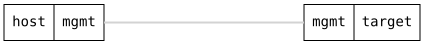

=== Alarms

ifdef::topdoc[:imagesdir: {topdoc}../../test/case/alarms/basic]

==== Description

Raise an external alarm with the raise-alarm operation and follow it
through the ietf-alarms alarm list: acknowledge it, clear it, shelve it
by configuration, and purge it.  A marker touched on the device shows
that a script raises an alarm the same way, and the CLI commands show,
acknowledge and clear it.  A device with unpatched ports has a link-down
alarm on each, so those are shelved first to keep the counts exact.

==== Topology

==== Sequence

. Set up topology and attach to target DUT
. Shelve link-down alarms on every interface of the target in shelf 'ports'
. Verify the login banner is silent
. Raise external alarm 'backup' with severity critical
. Verify alarm 'backup' is listed, critical and not cleared
. Verify summary counts one critical alarm, not cleared
. Acknowledge alarm 'backup' with the text 'On it'
. Verify alarm 'backup' has an operator state change 'ack' by admin
. Clear external alarm 'backup'
. Verify alarm 'backup' is cleared but still listed
. Touch marker /run/alarm/active/external/disk-full on target
. Verify alarm 'disk-full' is listed with severity indeterminate
. Add an alarm profile raising external alarms on 'disk-full' to warning
. Verify alarm 'disk-full' now has perceived severity warning
. Remove the alarm profile
. Verify alarm 'disk-full' is back at severity indeterminate
. Verify 'show alarms' lists 'disk-full' as active
. Verify the login banner counts one active alarm
. Verify 'show alarms disk-full' shows the alarm in full
. Acknowledge alarm 'disk-full' from the CLI with the text 'Known'
. Verify alarm 'disk-full' has an operator state change 'ack' by admin
. Touch marker /run/alarm/active/link-down/eth9 on target
. Verify the link-down alarm names eth9 by its instance-identifier
. Close alarm 'eth9' from the CLI without giving its type
. Verify alarm 'eth9' has an operator state change 'closed'
. Verify the login banner leaves the closed 'eth9' out
. Remove marker /run/alarm/active/link-down/eth9 on target
. Set update source to the unreachable http://192.0.2.1/releases.atom
. Run the update check on target
. Verify alarm 'software' of type update-check-failed is listed, minor
. Remove marker /run/alarm/active/update-check-failed/software on target
. Shelve alarms for resource 'disk-full'
. Verify alarm 'disk-full' moved to the shelved alarms
. Verify 'show alarms' hides 'disk-full' and 'show alarms shelved' lists it
. Verify the login banner is silent while 'disk-full' is shelved
. Verify the CLI refuses to acknowledge the shelved 'disk-full'
. Remove shelf 'known-full-disk'
. Verify alarm 'disk-full' is back in the alarm list
. Close every active alarm with one set-operator-state on the alarm list
. Verify alarm 'disk-full' has an operator state change 'closed' with the text 'Sweep'
. Clear alarm 'disk-full' from the CLI
. Verify alarm 'disk-full' is cleared
. Purge cleared alarms
. Verify alarms 'backup', 'disk-full', 'eth9' and 'software' are gone

