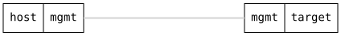

=== Link-Down Alarm

ifdef::topdoc[:imagesdir: {topdoc}../../test/case/alarms/link_down]

==== Description

A veth pair gives a link whose carrier the test controls from the
configuration: disabling one end takes carrier away from the other.
The surviving end must raise a link-down alarm once the hold-off has
passed, and the alarm must clear when the peer comes back.  The
disabled end itself must not alarm, it was taken down on purpose.

==== Topology

==== Sequence

. Set up topology and attach to target DUT
. Configure veth pair veth0a and veth0b, both enabled
. Verify veth0a has link and no alarm
. Disable veth0b
. Verify link-down alarm on veth0a, major and not cleared
. Verify no link-down alarm on veth0b, it was disabled on purpose
. Verify 'show alarms' lists veth0a as active
. Enable veth0b
. Verify link-down alarm on veth0a is cleared
. Remove veth pair
. Purge cleared alarms

