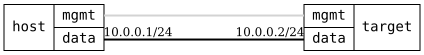

=== Container with Bridge Network

ifdef::topdoc[:imagesdir: {topdoc}../../test/case/containers/bridge]

==== Description

Verify connectivity with a simple web server container from behind a
bridge, the classic docker0 setup built from regular interfaces: the
container gets one end of a VETH pair, with a static address and a
default route, and the other end is a port in the bridge.

The firewall forwards port 8080 on the outside to port 80 in the
container, which has no other way in from the outside.

==== Topology

==== Sequence

. Set up topology and attach to target DUT
. Create bridge br0, 172.17.0.1/16, with VETH pair veth0a to veth0b
. Forward port 8080 on the data interface to 172.17.0.2 port 80
. Create httpd container from bundled OCI image, on veth0b
. Verify container has started
. Verify container is reachable on http://10.0.0.2:8080

