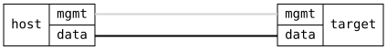

=== Container Restart Policy

ifdef::topdoc[:imagesdir: {topdoc}../../test/case/containers/restart_policy]

==== Description

Verify that a container that exits is started again as its restart
policy says.  Three containers without an image run a command of the
system that exits after a second: /bin/sleep 1.

 - 'never' is started once
 - 'retry' is started again 10 times, and then no more
 - 'always' is still being started again after that

A container that is no longer started again stays that way when other
configuration changes, until the start action is called.

==== Topology

==== Sequence

. Set up topology and attach to target DUT
. Create containers 'never', 'retry' and 'always', running /bin/sleep 1
. Verify container 'retry' is started 11 times, then has status 'exited (0)'
. Verify container 'never' was started 1 time, and has status 'exited (0)'
. Set hostname to 'changed'
. Verify container 'always' is started 3 more times
. Verify container 'never' is still started 1 time, and 'retry' 11 times
. Verify the start action starts container 'never' a 2nd time

