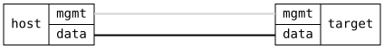

=== Container without Image

ifdef::topdoc[:imagesdir: {topdoc}../../test/case/containers/system]

==== Description

Verify that a container without an image runs the software of the
system itself: the web server that Infix ships, serving a page from
the configuration as a content mount, with host networking on port 91.

The container starts from the root file system of the system image,
not from the running system.  It has the hostname of the container and
it reports no image, its image ID is the version of the system.

==== Topology

==== Sequence

. Set up topology and attach to target DUT
. Create container 'web-system' without image, running /usr/sbin/httpd on port 91
. Verify container 'web-system' has started
. Verify 'It works, from the system' on http://target:91/index.html
. Verify the hostname in container 'web-system' is 'web-system'
. Verify container 'web-system' reports no image, and the system version as image ID

