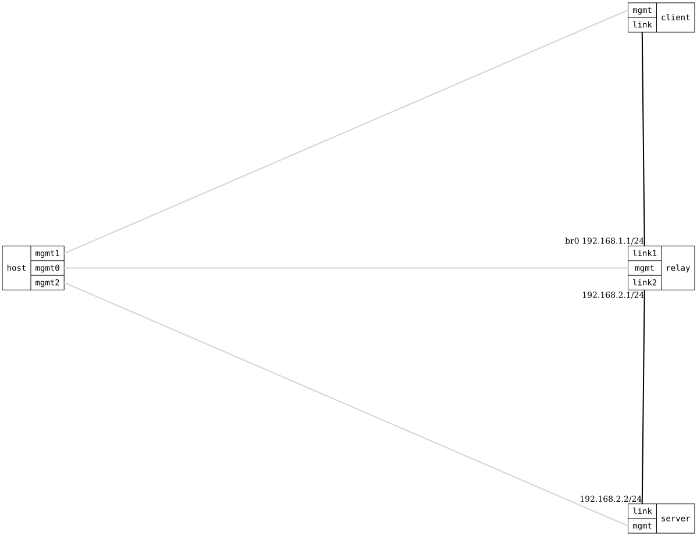

=== DHCP Relay

ifdef::topdoc[:imagesdir: {topdoc}../../test/case/dhcp/relay_basic]

==== Description

Verify that the relay agent relays requests from a bridge port to a
DHCP server on another subnet, and adds option 82 to them.  The port
has a configured circuit-id, and the relay agent a remote-id.  The
server has a static host that matches both, and a pool of one other
address, which the client gets if option 82 is missing or wrong.

==== Topology

==== Sequence

. Set up topology and attach to client, relay and server DUTs
. Configure DHCP server with static host for circuit-id camera-18
. Configure bridge and DHCP relay with circuit-id camera-18
. Enable DHCP client on client
. Verify client gets the address for camera-18, 192.168.1.42

