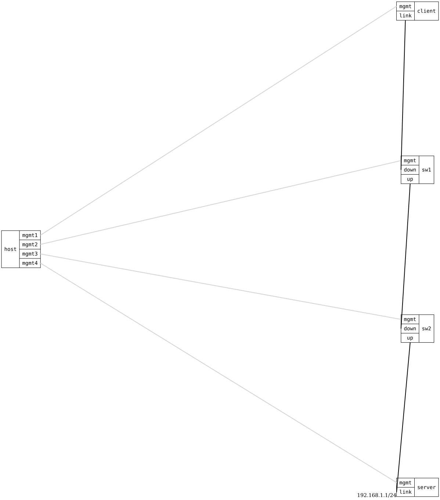

=== DHCP Relay Chain

ifdef::topdoc[:imagesdir: {topdoc}../../test/case/dhcp/relay_chain]

==== Description

Verify relay agents in a chain of two switches, with the DHCP server
at the end of the chain and everything in the same subnet.  Both
switches add option 82, so the server can hand out an address per
switch and port:

 - sw1 gets its own address with DHCP.  Its request has no option 82
   when it arrives on the trusted port of sw2, which adds its own.
 - The client is connected to sw1, which relays its request to the
   server through sw2.  The replies from the server arrive on a port
   that sw1 relays from.

The server has a pool of one other address, which sw1 or the client
gets if option 82 is missing or wrong.

==== Topology

==== Sequence

. Set up topology and attach to client, sw1, sw2 and server DUTs
. Configure DHCP server with static hosts 192.168.1.3 for sw1 and 192.168.1.42 for the client
. Configure sw2 with address 192.168.1.2 and DHCP relay, port to sw1 trusted
. Configure sw1 with DHCP client and DHCP relay, port to sw2 trusted
. Verify sw1 gets the address for its port on sw2, 192.168.1.3
. Enable DHCP client on client
. Verify client gets the address for its port on sw1, 192.168.1.42

