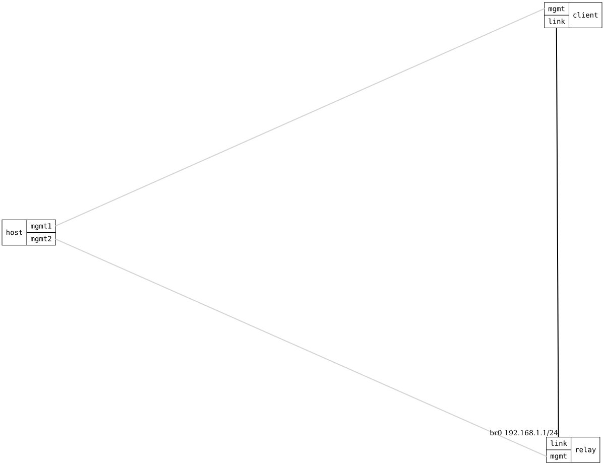

=== DHCP Relay with Local Server

ifdef::topdoc[:imagesdir: {topdoc}../../test/case/dhcp/relay_local]

==== Description

Verify that a device can hand out an address per port: the relay agent
adds option 82 to requests from a bridge port and relays them to the
DHCP server on the same device, which has a static host matching the
circuit-id of the port, by default the name of the port.

The static host has preempt enabled.  When the client is replaced, here
by changing the MAC address of the client, the new one gets the same
address at once, even though the lease of the old one has not expired.

==== Topology

==== Sequence

. Set up topology and attach to client and relay DUTs
. Configure relay with br0, DHCP relay to 127.0.0.1 and static host 192.168.1.42 for the port
. Enable DHCP client on client
. Verify client gets the address of the port, 192.168.1.42
. Change MAC address of client to 02:00:00:00:00:99
. Verify lease for 192.168.1.42 is held by 02:00:00:00:00:99

