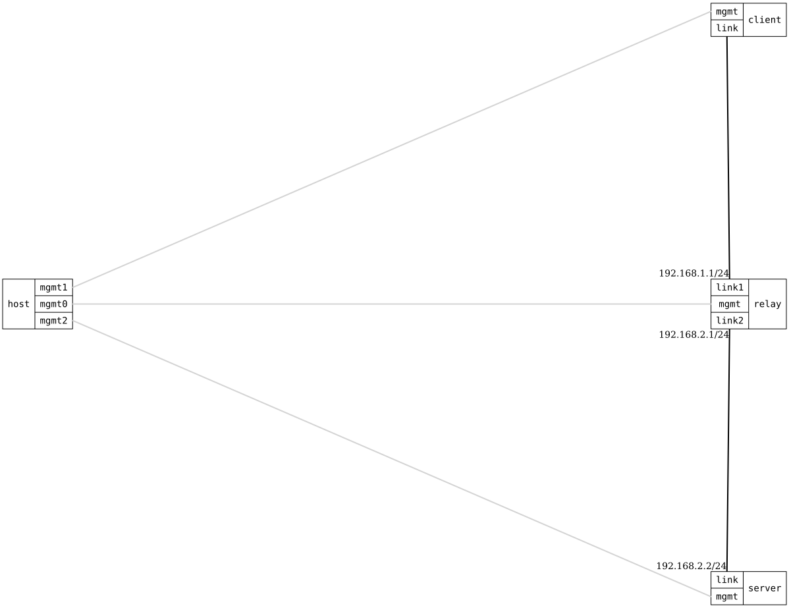

=== DHCP Relay without Option 82

ifdef::topdoc[:imagesdir: {topdoc}../../test/case/dhcp/relay_plain]

==== Description

Verify that the relay agent relays requests from an interface that is
not a bridge, and that option 82 can be turned off for one interface
while it is enabled for the relay agent.  The server has a static host
that matches the default circuit-id of the interface, its name, and a
pool of one other address.

The client first gets the address of the static host.  With option 82
turned off for the interface, a new client, here the same one with
another MAC address, gets the pool address.

==== Topology

==== Sequence

. Set up topology and attach to client, relay and server DUTs
. Configure DHCP server with pool 192.168.1.100 and static host 192.168.1.42 for the relay interface
. Configure DHCP relay with option 82 on the client interface
. Enable DHCP client on client
. Verify client gets the address of the static host, 192.168.1.42
. Disable option 82 for the client interface on relay
. Change MAC address of client to 02:00:00:00:00:99
. Verify client gets the pool address, 192.168.1.100

