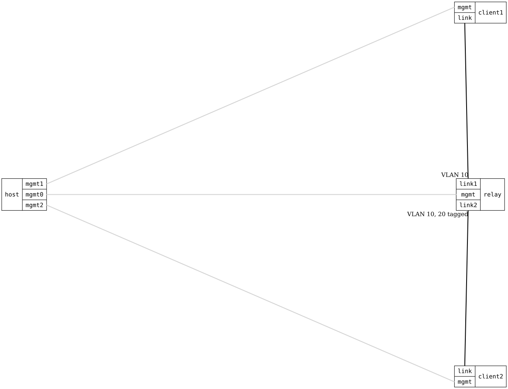

=== DHCP Relay with VLANs

ifdef::topdoc[:imagesdir: {topdoc}../../test/case/dhcp/relay_vlan]

==== Description

Verify the relay agent on a VLAN filtering bridge, with the DHCP server
on the same device and a subnet per VLAN.  Port link1 is an access port
in VLAN 10 and port link2 a trunk port with VLAN 10 and 20.  The server
has a static host per port and VLAN:

 - client1, untagged on the access port, gets 192.168.10.42
 - client2, tagged with VLAN 10 on the trunk port, gets 192.168.10.43
 - client2, tagged with VLAN 20 on the trunk port, gets 192.168.20.43

==== Topology

==== Sequence

. Set up topology and attach to relay, client1 and client2 DUTs
. Configure relay with bridge br0, VLAN 10 and 20, access port link1 and trunk port link2
. Configure DHCP relay on vlan10 and vlan20, and DHCP server with a static host per port and VLAN
. Enable DHCP client on client1, and on VLAN 10 and 20 of client2
. Verify client1 gets 192.168.10.42
. Verify client2 gets 192.168.10.43 on VLAN 10
. Verify client2 gets 192.168.20.43 on VLAN 20

