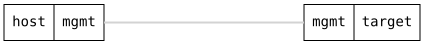

=== USB Configuration

ifdef::topdoc[:imagesdir: {topdoc}../../test/case/hardware/usb]

==== Description

This test checks if the configuration is consistent with hardware state,
and verifies whether the USB ports are correctly _locked_ (restricted from
use) and _unlocked_ (available for use) when they should. It also verifies
this behavior during reboot. This test does not involve the actual use of
the USB port; it only ensures the configured state is consistent with the
hardware state.  Removing the configuration of a port locks it.

The target has a USB stick plugged in.  It is expected to be listed
under its port the whole time: not authorized while the port is
locked, authorized as mass storage once the port is unlocked.

If this pass you can be certain that the configuration of the USB
port is handled correctly.

==== Topology

==== Sequence

. Set up topology and attach to target DUT
. Unlock all USB ports
. Verify that all USB ports are unlocked
. Verify that the USB stick is authorized
. Lock all USB ports
. Verify that all USB ports are locked
. Verify that the USB stick is still listed, not authorized
. Unlock all USB ports again
. Verify that all USB ports are unlocked
. Remove all hardware configuration
. Verify that all USB ports are locked
. Unlock USB ports
. Verify that all USB ports are unlocked
. Save the configuration to startup configuration and reboot
. Verify USB port remain unlocked after reboot

