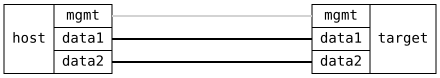

=== Bridge FDB Basic

ifdef::topdoc[:imagesdir: {topdoc}../../test/case/interfaces/bridge_fdb_basic]

==== Description

Verify the unicast forwarding database (FDB) of a VLAN filtering bridge:
the configured aging time, and a static entry and an address learned
from traffic through the bridge, both listed by the
get-forwarding-database action.

....

,------------------------------------------,
|                                          |
|                    br0 (VLAN 10)         |
|                   /     \                |
| target:mgmt   target:data1  target:data2 |
'------------------------------------------'
        |                |     |
        |                |     |
,------------------------------------------,
|   host:mgmt   host:data1     host:data2  |
|               [10.0.0.1]     [10.0.0.2]  |
|                  (ns1)         (ns2)     |
|                                          |
|                 [ HOST ]                 |
'------------------------------------------'

....

==== Topology

==== Sequence

. Set up topology and attach to target DUT
. Configure VLAN 10 bridge with aging time and a static FDB entry
. Verify the bridge aging time
. Verify the static FDB entry on target:data2 in VLAN 10
. Verify host:data1 is learned on target:data1 after a ping
. Remove the static FDB entry and verify it is gone

