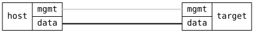

=== Bridge STP on a VLAN filtering bridge

ifdef::topdoc[:imagesdir: {topdoc}../../test/case/interfaces/bridge_stp_vlan]

==== Description

Spanning tree is enabled on a VLAN filtering bridge whose port already
is a member of a VLAN.  The port has to keep its VLAN, and later
changes to the bridge, here a second VLAN, have to be applied.  The
port also has to keep forwarding in its VLANs when spanning tree is
disabled again.

==== Topology

==== Sequence

. Set up topology and attach to target DUT
. Configure br0 with VLAN 10: target:data untagged with PVID 10, address 10.0.0.2/24 on vlan10
. Verify host:data reaches 10.0.0.2
. Enable spanning tree on br0
. Verify target:data is forwarding in the spanning tree
. Verify host:data reaches 10.0.0.2
. Add VLAN 20 to br0 with target:data tagged
. Verify target:data is a tagged member of VLAN 20
. Verify host:data reaches 10.0.0.2
. Disable spanning tree on br0
. Verify target:data is an untagged member of VLAN 10 and a tagged member of VLAN 20
. Verify host:data reaches 10.0.0.2

