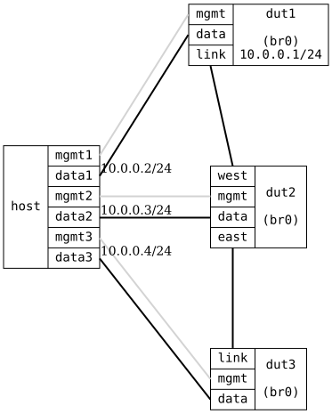

=== IGMP Basic 3 DUTs

ifdef::topdoc[:imagesdir: {topdoc}../../test/case/interfaces/igmp_basic_3duts]

==== Description

The same check as IGMP basic, spread over three bridges in a chain so
that each DUT only needs a single port facing the host.  A multicast sender sits
behind dut1, a non-member behind dut2, and the receiver behind dut3.
The membership report from the receiver must propagate through dut3
and dut2 up to the querier on dut1 before dut2 prunes the group from
its own host port.

....
   10.0.0.1
 .-----------.       .----------------.       .-----------.
 |   dut1    |       |      dut2      |       |   dut3    |
 '-data-link-'-------'-west-data-east-'-------'-link-data-'
    |                       |                       |      10.0.0.0/24
 .-data1-.               .-data2-.               .-data3-.
 | msend |               | !memb |               | mrecv |
 '-------'               '-------'               '-------'
    .2                      .3                      .4
                          HOST
....

With no membership the group 224.1.1.1 is flooded to both `!memb` and
`mrecv`.  Once `mrecv` joins, dut2 and dut1 learn the group on their
links toward dut3, and `!memb` no longer receives it.

==== Topology

==== Sequence

. Set up topology and attach to target DUTs
. Configure bridges with IGMP snooping on all DUTs, querier on dut1 with 10.0.0.1/24
. Verify host:data1, host:data2 and host:data3 can reach 10.0.0.1
. Start multicast sender on host:data1, group 224.1.1.1
. Verify group 224.1.1.1 is flooded to host:data2 and host:data3
. Join multicast group 224.1.1.1 on host:data3
. Verify dut3 has learned group 224.1.1.1 on dut3:data
. Verify dut2 has learned group 224.1.1.1 on dut2:east
. Verify dut1 has learned group 224.1.1.1 on dut1:link
. Verify group 224.1.1.1 is still received on host:data3
. Verify group 224.1.1.1 is no longer received on host:data2

