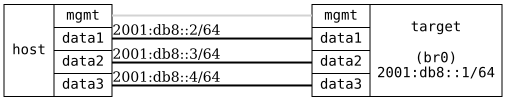

=== MLD Basic

ifdef::topdoc[:imagesdir: {topdoc}../../test/case/interfaces/mld_basic]

==== Description

Verify basic MLD snooping behavior on a bridge.  Without any MLD
membership, IPv6 multicast should be flooded to all ports.  Once a host
joins a group, the bridge should learn the membership via MLD and only
forward matching multicast to the member port, pruning it from
non-member ports.

....
            2001:db8::1
 .---------------------------.
 |            DUT            |
 '-data1-----data2-----data3-'
     |         |         |
     |         |         |      2001:db8::/64
     |         |         |
 .-data1-. .-data2-. .-data3-.
 | msend | | mrecv | | !memb |
 '-------' '-------' '-------'
    ::2       ::3       ::4
             HOST
....

The bridge has IPv6 enabled, so it is the MLD querier on the LAN, with
its link-local address as source.  A multicast sender on `msend` sends
to group ff2e::1.  First, with no MLD joins, verify the group is flooded
to both `mrecv` and `!memb`.  Then `mrecv` joins the group and the test
waits for the bridge MDB to reflect the membership before verifying
that `!memb` no longer receives the group.

==== Topology

==== Sequence

. Set up topology and attach to target DUT
. Configure bridge with MLD snooping and IPv6 address 2001:db8::1/64
. Verify the bridge is the MLD querier, using its link-local address
. Verify host:data1, host:data2 and host:data3 can reach 2001:db8::1
. Start multicast sender on host:data1, group ff2e::1
. Verify group ff2e::1 is flooded to host:data2 and host:data3
. Join multicast group ff2e::1 on host:data2
. Verify the bridge has learned group ff2e::1 on target:data2
. Verify group ff2e::1 is still received on host:data2
. Verify group ff2e::1 is no longer received on host:data3

