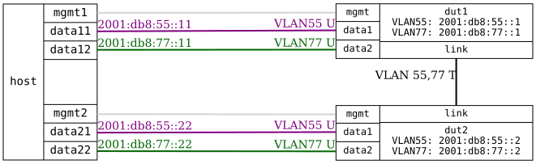

=== MLD VLAN

ifdef::topdoc[:imagesdir: {topdoc}../../test/case/interfaces/mld_vlan]

==== Description

Verify MLD querier election and group learning per VLAN on a VLAN
filtering bridge, and that VLAN separation is respected for IPv6
multicast.

....
 vlan55 2001:db8:55::1                     vlan55 2001:db8:55::2
 vlan77 2001:db8:77::1                     vlan77 2001:db8:77::2
           .--------------.  VLAN 55,77 T  .---------------.
           | DUT1    link +----------------+ link     DUT2 |
           '-+----------+-'                '-+-----------+-'
       data1 | 55U  77U | data2        data1 | 55U   77U | data2
             |          |                    |           |
        .----+--.  .----+-----.         .----+-----.  .--+----.
        | msend |  | !memb    |         | mreceive |  | msend |
        '-------'  '----------'         '----------'  '-------'
          ::11       ::11                  ::22          ::22
....

Both DUTs have IPv6 enabled on their VLAN interfaces, so in each VLAN
they must agree on one MLD querier, the one with the lowest link-local
address.  The other DUT receives the queries on its link port, and
learns it as a multicast router port in that VLAN.

A sender in VLAN 55 on DUT1 sends to ff2e::55 and a sender
in VLAN 77 on DUT2 sends to ff2e::77.  Each group is flooded within its
own VLAN, and never leaks into the other.  Once the receiver in VLAN 55
on DUT2 joins ff2e::55, DUT2 learns the group on that port.

==== Topology

==== Sequence

. Set up topology and attach to target DUTs
. Configure VLAN 55 and 77 with MLD snooping, and IPv6 on the VLAN interfaces
. Verify the DUTs agree on one MLD querier in VLAN 55 and in VLAN 77
. Verify the DUT that is not querier has learned its link port as router port in VLAN 55 and 77
. Verify the hosts can reach the DUTs in their VLAN
. Start multicast senders on host:data11, group ff2e::55, and host:data22, group ff2e::77
. Verify group ff2e::55 is flooded to host:data21 and ff2e::77 to host:data12
. Verify ff2e::55 does not leak into VLAN 77, nor ff2e::77 into VLAN 55
. Join multicast group ff2e::55 on host:data21
. Verify dut2 has learned group ff2e::55 on dut2:data1 in VLAN 55
. Verify group ff2e::55 is still received on host:data21, and not in VLAN 77

