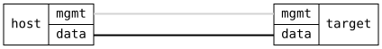

=== QoS Ingress Classification and Egress Remarking

ifdef::topdoc[:imagesdir: {topdoc}../../test/case/interfaces/qos_ingress_classify]

==== Description

Classification is how a port decides the priority of each frame it
receives, from the frame's VLAN priority (PCP) or its IP marking
(DSCP).  Remarking writes the priority back into those fields when the
frame leaves.  This test configures both on a port and checks that
the port has set up what was configured.  It sends no traffic: the
DSCP Classification and Bridge Classification tests do that.

The configuration:

 - trust dscp-pcp: use the DSCP where a frame has one, the PCP
   otherwise
 - default priority 2 for a frame with neither
 - PCP preset ieee: PCP n to priority n
 - DSCP preset ietf: RFC 4594 groups, e.g. EF (46) to priority 5
 - remark pcp and dscp from priority: priority 5 to PCP 5 and DSCP 40

On a switch port whose driver supports it, the settings go to the
switch hardware: the kernel's DCB tables must match and the
operational datastore must report classification and remarking as
offloaded.  On any other port the kernel does the work: the same
classification must be installed as tc flower rules on the port's
ingress, in trust order, with a catch-all for the default priority,
and DSCP remarking as pedit rules on its egress.  PCP remarking needs
driver support.

Removing the configuration returns the port to the defaults: trust pcp
with default priority 0, and no remarking.

==== Topology

==== Sequence

. Set up topology and attach to target DUT
. Configure trust dscp-pcp, default priority 2, presets, and remarking
. Verify dcb apptrust order is dscp pcp
. Verify dcb app default priority and PCP and DSCP maps
. Verify dcb rewr priority to PCP and DSCP maps
. Verify classification and remarking are reported as offloaded
. Verify tc flower rules: DSCP block before PCP block, then default
. Verify DSCP remarking as pedit rules on egress
. Verify classification is not reported as offloaded
. Remove qos configuration and verify the defaults are back

