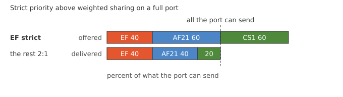

=== QoS Mixed Selection

ifdef::topdoc[:imagesdir: {topdoc}../../test/case/interfaces/qos_mixed_selection]

==== Description

Strict priority and weighted sharing can run together on one port: the
strict classes are served first and the weighted classes divide what
is left.  This is the usual setup for a port that carries voice or
control traffic next to ordinary data.  This test fills a port with
three flows and checks both rules at once.

.What the three talkers offer and what the port must deliver

Three talkers, marked EF, AF21 and CS1, send through the DUT's bridge
and out one port.  That port is slowed down so the test's traffic can
fill it: negotiated down to 100 Mbit/s, or shaped to 10 Mbit/s where
it has no PHY.  The port where the traffic enters puts EF in a strict
class above AF21 and CS1, which share the rest 2:1.

EF offers 40 percent of what the port can send and the other two
60 percent each, 160 percent in all.  EF must arrive intact.  AF21 and
CS1 must divide what EF leaves 2:1, within five points, and both must
be held back by more than a tenth of what they offer.

The weights are set as 60 and 30 percent.  Every class below a
weighted one must be weighted too, so the two classes below get the
remaining ten percent, five each, and carry no traffic.

==== Topology

image::topology.svg[QoS Mixed Selection topology, align=center, scaledwidth=75%]

==== Sequence

. Set up topology and attach to target DUT
. Bridge the two ports, classify by DSCP on ingress, EF strict above AF21 and CS1 at 2:1
. Slow the egress port so its queues can fill
. Set up the talker and listener namespaces
. EF at 40 percent, AF21 and CS1 at 60 percent each
. Verify EF arrived intact
. Verify AF21 and CS1 were both held back and split the rest 2:1

