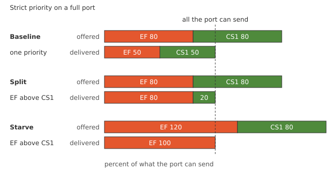
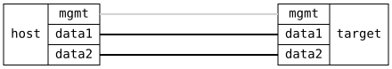

=== QoS Strict Priority

ifdef::topdoc[:imagesdir: {topdoc}../../test/case/interfaces/qos_strict_priority]

==== Description

When a port has more to send than it can carry, strict priority decides
who goes first: a higher traffic class is always served before a lower
one.  This test fills a port with two flows and checks that the
important one gets through untouched, also when that leaves nothing
for the other.

.What the two talkers offer and what the port must deliver

Two talkers, one marked EF and one marked CS1, send through the DUT's
bridge and out one port.  That port is slowed down so the test's
traffic can fill it: negotiated down to 100 Mbit/s, or shaped to
10 Mbit/s where it has no PHY.  The port where the traffic enters
decides the priority of each flow from its DSCP marking.

Three measurements:

 - baseline: both markings get the same priority and each talker offers
   80 percent of what the port can send.  They share one queue and
   CS1 must keep at least a tenth of the port, so whatever the next
   two measurements show comes from the priorities
 - split: EF gets the higher priority, 80 percent each.  EF must
   arrive without loss and CS1 gets what is left
 - starve: EF offers 120 percent of the port.  CS1 must get less than
   5 percent

In every measurement the port must hold back more than a tenth of what
is offered, which shows it was full.

==== Topology

==== Sequence

. Set up topology and attach to target DUT
. Bridge the two ports, classify by DSCP on ingress, control traffic with CS1
. Slow the egress port so its queues can fill
. Set up the talker and listener namespaces
. Baseline: both flows at one priority, 80 percent each, expect neither starved
. Split: EF strict above CS1, 80 percent each, expect EF without loss
. Starve: EF at 120 percent of the port, expect CS1 below 5 percent

