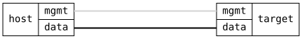

=== QoS Time-Aware Shaper

ifdef::topdoc[:imagesdir: {topdoc}../../test/case/interfaces/qos_tas]

==== Description

Configure an IEEE 802.1Qbv gate control list on a port: a 100 µs cycle
with the top class alone for 20 µs, the top class and class 5 for
20 µs, and every other class for the remaining 60 µs.  The port must
run the list and report it back as the operational control list, with
the cycle and base time as given.

The gates exclude what cannot run under them: a port rate limit, since
the schedule takes the root, and weighted classes, since gated classes
are served strictly.  Both are rejected.  Skipped on a product without
the TSN modules, and a port with fewer transmit queues than traffic
classes rejects the schedule instead of running it, which is checked.

==== Topology

==== Sequence

. Set up topology and attach to target DUT
. Reject a gate control list together with a port rate limit
. Reject a gate control list together with a weighted class
. Reject an empty gate control list
. Reject the schedule on a port with fewer transmit queues than classes
. Enable the gate control list on the port
. Verify the port reports the list, cycle and base time it runs

