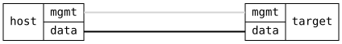

=== QoS Traffic Classes and Transmission Selection

ifdef::topdoc[:imagesdir: {topdoc}../../test/case/interfaces/qos_traffic_class]

==== Description

A port sorts the frames it sends into traffic classes by priority, and
serves each class by strict priority or by a weighted share.  This
test sets up a layout of its own on a port and checks that the port
runs what was configured.  It sends no traffic: the Strict Priority,
Weighted Sharing and Mixed Selection tests check what a layout does to
a full port.

Checked in turn:

 - a custom priority to traffic class map, with the two lowest classes
   sharing 67:33 and the rest strict priority
 - the `ieee-sr` preset, which puts the stream reservation classes,
   priorities 2 and 3, on the two highest classes
 - a 10 Mbit/s egress shaper on top of the classes, and its removal
 - removing all QoS settings, which brings back the default table,
   IEEE 802.1Q-2022 Table 8-5

After each change the port's scheduler is read back from the kernel.
It must be an ets qdisc with the strict bands first, the shares as
quanta of one frame per percent, and the priomap inverted as 802.1Q
numbering requires.  The egress shaper must be a tbf root qdisc above
the same ets table.  The operational datastore must report throughout
whether the port's switch hardware runs transmission selection.

The port's class count comes from its transmit queues, or eight for a
single-queue port.

==== Topology

==== Sequence

. Set up topology and attach to target DUT
. Configure a custom map, the two lowest classes sharing 67:33
. Verify the root qdisc carries the custom map and shares
. Verify the offload capability matches the qdisc
. Switch to the ieee-sr preset and verify SR classes on top
. Add a 10 Mbit/s egress shaper and verify the tbf root above the ets table
. Remove the egress shaper and verify the scheduler is the root again
. Remove qos configuration and verify the default table is back

