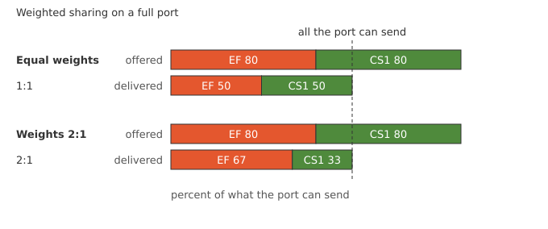

=== QoS Weighted Sharing

ifdef::topdoc[:imagesdir: {topdoc}../../test/case/interfaces/qos_weighted_sharing]

==== Description

Weighted sharing divides a full port between traffic classes in the
proportions configured, so every class keeps its share however much
the others offer.  This test fills a port with two flows and checks
that the split follows the weights.

.What the two talkers offer and what the port must deliver

Two talkers, one marked EF and one marked CS1, send through the DUT's
bridge and out one port.  That port is slowed down so the test's
traffic can fill it: negotiated down to 100 Mbit/s, or shaped to
10 Mbit/s where it has no PHY.  The port where the traffic enters puts
the two flows in two traffic classes, both running enhanced
transmission selection, the weighted algorithm of IEEE 802.1Q.  Each
talker offers 80 percent of what the port can send, so both classes
always have frames waiting.

Two measurements:

 - equal weights must give an even split.  This is the baseline, and
   fails on its own if the weights land on the wrong classes
 - weights 2:1 must give one flow two thirds and the other one third

Each flow's share of what the port delivers must be within five points
of its weight.  Both flows must also be held back by more than a tenth
of what they offer, which shows the port was full.

The weights are set as 45 and 45 percent, then 60 and 30.  Every class
below a weighted one must be weighted too, so the two classes below
get the remaining ten percent, five each, and carry no traffic.

==== Topology

image::topology.svg[QoS Weighted Sharing topology, align=center, scaledwidth=75%]

==== Sequence

. Set up topology and attach to target DUT
. Bridge the two ports, classify by DSCP on ingress, EF and CS1 in two weighted classes
. Slow the egress port so its queues can fill
. Set up the talker and listener namespaces
. Equal weights, both flows at 80 percent, expect an even split
. Weights 2:1, both flows at 80 percent, expect a 67:33 split

