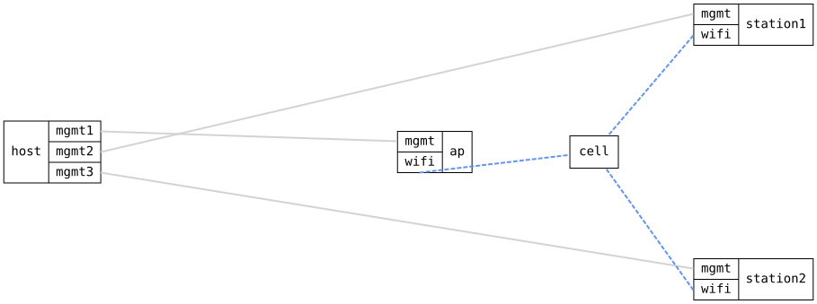

=== WiFi Access Point with client isolation

ifdef::topdoc[:imagesdir: {topdoc}../../test/case/interfaces/wifi_ap_client_isolation]

==== Description

One Access Point and two Stations, each on its own DUT.  Without client
isolation the stations reach each other through the Access Point.  With
client isolation enabled they still reach the Access Point, but no
longer each other.

Topology:
....
                       ((( station1 ==(mgmt)== host
    host ==(mgmt)== ap
                       ((( station2 ==(mgmt)== host
....

==== Topology

==== Sequence

. Set up topology and attach to the ap and two stations
. Configure the ap as an Access Point without client isolation
. Configure the stations with 192.168.20.11/24 and 192.168.20.12/24
. Verify both stations associate to the ap
. Verify station1 reaches the ap on 192.168.20.1
. Verify station1 reaches station2 on 192.168.20.12
. Enable client isolation on the ap
. Verify both stations are associated to the ap
. Verify station1 still reaches the ap on 192.168.20.1
. Verify station2 still reaches the ap on 192.168.20.1
. Verify station1 no longer reaches station2 on 192.168.20.12

