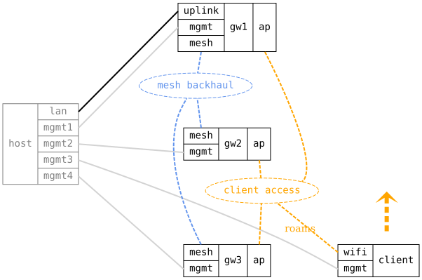

=== WiFi Mesh backhaul with roaming Access Points

ifdef::topdoc[:imagesdir: {topdoc}../../test/case/interfaces/wifi_mesh_roaming]

==== Description

Verifies the setup from the blog post "Seamless Wi-Fi with Mesh Backhaul
and Roaming", https://www.kernelkit.org/posts/wifi-mesh-roaming/

Three gateway nodes, gw1, gw2 and gw3, each have two radios:

- radio0 is an 802.11s mesh point.  The three join one mesh, "backhaul",
  on 5GHz.  It carries traffic between the nodes, so only gw1 needs a
  wire to the rest of the LAN
- radio1 is a WPA2/WPA3-personal Access Point on 2.4GHz.  All three use
  the same SSID, "campus", and the same 802.11r mobility domain, so a
  client roams between them as in one network

Each node bridges its mesh and AP into br0, gw1 also its wired uplink, so
the mesh is a transparent layer-2 backhaul.  A fourth node is the client.

The test verifies that:

1. the three nodes form a mesh: each lists the other two as peers, and
   reports its mesh id and that forwarding is enabled
2. the client associates to the "campus" SSID
3. traffic reaches the client across the mesh backhaul: the host behind
   gw1 pings the client, which is attached to one of the gw APs
4. the client roams: it is connected to one of the three gw APs, and when
   that AP is taken down it moves to another gw with the same SSID and
   mobility domain, its BSSID changes, and traffic recovers

In simulation every radio hears every other at the same strength, so
nothing makes the client drift between APs.  Step 4 forces the move
instead, which checks that a second AP accepts the client and that the
backhaul re-converges.

==== Topology

==== Sequence

. Set up topology and attach to gw1, gw2, gw3 and the client
. Configure gw1, gw2, gw3 as mesh nodes with a roaming AP
. Configure the client as a station for the 'campus' SSID
. Verify each node lists the other two nodes as mesh peers
. Verify each node reports mesh-id 'backhaul' with forwarding enabled
. Verify the client associates to the 'campus' SSID
. Verify the client is connected to one of the campus APs
. Verify the client is reachable across the mesh
. Take down the client's current AP to force a roam
. Verify the client roams to another node's AP
. Verify connectivity is restored after roaming
. Stop the WiFi service on the client's current node
. Verify the client roams to the remaining node's AP
. Verify the client was asked to move, given candidates, and roamed without disconnecting
. Verify connectivity is restored after the handover
. Start the WiFi service again on the stopped node

