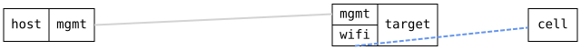

=== WiFi radio settings the hardware cannot do are refused

ifdef::topdoc[:imagesdir: {topdoc}../../test/case/interfaces/wifi_radio_validation]

==== Description

A radio reports the channels it supports.  A channel outside the
configured band and a channel the country code does not allow must be
refused when configured, with an error that names the radio and the
setting.  A setting the radio does support must still be accepted
afterwards.

Topology:
....
    host ==(mgmt)== target  )))  ~ cell ~
....

==== Topology

==== Sequence

. Set up topology and attach to target DUT
. Configure radio0 for 2.4GHz channel 1 with country code SE
. Verify radio0 supports channel 13 but not channel 14
. Reject channel 36 in band 2.4GHz on radio0
. Reject channel 14 in band 2.4GHz on radio0
. Configure radio0 for 2.4GHz channel 13

