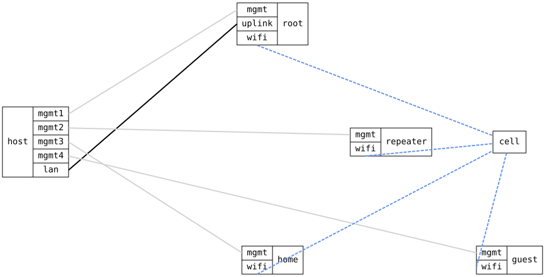

=== WiFi repeater with two SSIDs in VLANs over a 4-address (WDS) backhaul

ifdef::topdoc[:imagesdir: {topdoc}../../test/case/interfaces/wifi_wds_repeater]

==== Description

Four DUTs.  The root runs the backhaul access point 'infix-backhaul' and
a VLAN filtering bridge: the WDS port and the wired uplink carry VLAN 10
and VLAN 20 tagged, and the root serves DHCP in each VLAN.  The repeater
has a 4-address station on the backhaul, carrying both VLANs tagged, and
two access points on the same radio as access ports: 'infix-home'
untagged in VLAN 10 and 'infix-guest' untagged in VLAN 20.  Two plain
stations join them, one per SSID.

Each station must lease an address from the DHCP server of its own VLAN
on the root.  That proves both that the 4-address backhaul carries the
stations' own MAC addresses and that the VLAN tags survive the trip.
The host behind the root reaches both stations on their VLANs.

Taking the backhaul down and up again shows it is a transparent bridge
port: the stations lose and regain reach without re-associating.

The repeater's interfaces get addresses derived from the chassis MAC,
by position on the radio.  Adding a third access point that sorts
between the two moves the guest access point one up, and removing it
moves it back; the guest station follows and the backhaul comes back
each time.  Finally the guest access point gets a fixed MAC address,
which recreates its netdev.  The home access point on the same radio
must not be disturbed, and the guest access point has to come back at
the new address with its client.

Topology:
....
    host ==(lan, VLAN 10+20)== root (AP 'infix-backhaul')
                                wds0 )))  ~ cell ~  ((( wifi0 repeater wifi1-home (AP 'infix-home', VLAN 10)  ))) home
                                                                      wifi1-guest (AP 'infix-guest', VLAN 20) ))) guest
....

==== Topology

==== Sequence

. Set up topology and attach to the root, the repeater, home and guest
. Configure home as a DHCP station for 'infix-home' and guest as a DHCP station for 'infix-guest'
. Configure the repeater with a 4-address station tagged in VLAN 10 and 20, access point 'infix-home' untagged in VLAN 10 and 'infix-guest' untagged in VLAN 20
. Verify the repeater's wifi0, wifi1 and wifi2 got the first three addresses derived from its chassis MAC
. Configure the root with access point 'infix-backhaul', WDS port wds0 for the repeater's station and the uplink tagged in VLAN 10 and 20, DHCP in each VLAN with fixed addresses for home and guest
. Verify the repeater's wifi0 associates to 'infix-backhaul'
. Verify wds0 on the root is up
. Verify home is on the repeater's 'infix-home' access point
. Verify guest is on the repeater's 'infix-guest' access point
. Verify home leases 10.10.0.9 from the root's VLAN 10 DHCP server through the backhaul
. Verify guest leases 10.20.0.9 from the root's VLAN 20 DHCP server through the backhaul
. Verify the host reaches home at 10.10.0.9 on VLAN 10 through the repeater
. Verify the host reaches guest at 10.20.0.9 on VLAN 20 through the repeater
. Disable the repeater's backhaul station wifi0
. Verify home at 10.10.0.9 and guest at 10.20.0.9 are no longer reachable from the host
. Enable the repeater's backhaul station wifi0 again
. Verify the host reaches home at 10.10.0.9 and guest at 10.20.0.9 again
. Add access point 'infix-iot' as wifi10 on the repeater, sorting between wifi1 and wifi2
. Verify wifi2 on the repeater moved to the fourth derived address and guest followed it
. Verify the host reaches home at 10.10.0.9 and guest at 10.20.0.9 with the third access point added
. Remove access point wifi10 from the repeater
. Verify wifi2 on the repeater is back at the third derived address and guest followed it
. Verify the host reaches home at 10.10.0.9 and guest at 10.20.0.9 with the third access point removed
. Change the address of the repeater's 'infix-guest' access point to 02:00:00:00:0b:12
. Verify wifi1-guest on the repeater reports the new address and both access points are up
. Verify guest associates to 'infix-guest' at the new address, BSSID 02:00:00:00:0b:12
. Verify the host reaches home at 10.10.0.9 and guest at 10.20.0.9 after the address change
. Verify home is still on its access point

