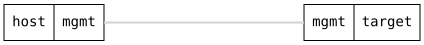

=== On-Change Subscription

ifdef::topdoc[:imagesdir: {topdoc}../../test/case/misc/on_change]

==== Description

Verify that a client subscribed to changes in the operational datastore
is told within a second when an interface loses its link and when the
link returns, without polling.  A veth pair gives a link the test
controls: disabling one end takes the link away from the other.  One
subscription follows the operational state of the interfaces, a second
one the alarm list, where the lost link raises a link-down alarm that
is cleared when the link returns.

==== Topology

==== Sequence

. Set up topology and attach to target DUT
. Configure veth pair veth0a and veth0b, both enabled
. Verify veth0a is up
. Subscribe to changes of oper-status in the operational datastore
. Verify the subscription starts with the oper-status of all interfaces
. Subscribe to changes of the alarm list in the operational datastore
. Verify the alarm subscription starts with the alarm list
. Disable veth0b
. Verify the subscription reports veth0a no longer up within 1 second
. Verify the alarm subscription reports a link-down alarm on veth0a within 15 seconds
. Enable veth0b
. Verify the subscription reports veth0a up within 1 second
. Verify the alarm subscription reports the alarm on veth0a cleared within 2 seconds
. Remove veth pair
. Purge cleared alarms

