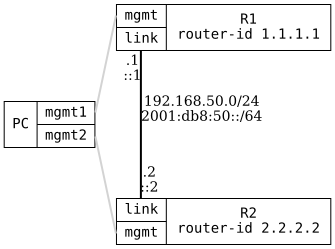

=== RIP Dual Stack

ifdef::topdoc[:imagesdir: {topdoc}../../test/case/routing/dual_stack]

==== Description

The status of each RIP instance must stay visible in the operational
datastore when the IPv4 and IPv6 versions run at the same time.

R1 and R2 have an IPv4 and an IPv6 address on the link between them, with
RIP for both address families on that link.  The test waits until the
operational datastore shows the neighbor in each instance, a full
adjacency for OSPF and a known peer for RIP.  A RIP router does not send
the link prefix back on the link, so each router also redistributes a
loopback address to have something to advertise.

==== Topology

==== Sequence

. Set up topology and attach to target DUTs
. Configure RIP for IPv4 and IPv6 on R1 and R2
. Wait for the IPv4 RIP neighbor on R1 and R2
. Wait for the IPv6 RIP neighbor on R1 and R2

