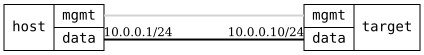

=== LLDP Fast Start

ifdef::topdoc[:imagesdir: {topdoc}../../test/case/services/lldp/lldp_fast_start]

==== Description

Verify that a new LLDP neighbor is answered at once with four frames,
sent message-fast-tx seconds apart.

==== Topology

==== Sequence

. Set up topology and attach to target DUT
. Enable LLDP with message-tx-interval 30 and message-fast-tx 2
. Verify LLDP frame on host:data
. Send LLDP frame from host:data
. Verify four LLDP frames, 2 seconds apart, on host:data

