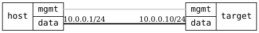

=== LLDP Management Address

ifdef::topdoc[:imagesdir: {topdoc}../../test/case/services/lldp/lldp_management_address]

==== Description

Verify that LLDP advertises all addresses of the device as management
addresses, and that management-interface limits them to the addresses
of the listed interfaces.

==== Topology

==== Sequence

. Set up topology and attach to target DUT
. Configure 10.0.0.10/24 on target:data and 192.168.50.1/24 on dummy0
. Enable LLDP
. Verify 10.0.0.10 and 192.168.50.1 are advertised on host:data
. Set management-interface to target:data
. Verify only 10.0.0.10 is advertised on host:data
. Remove management-interface
. Verify 10.0.0.10 and 192.168.50.1 are advertised on host:data

