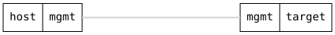

=== RESTCONF Event Stream

ifdef::topdoc[:imagesdir: {topdoc}../../test/case/services/restconf/streams]

==== Description

Verify that a client can subscribe to notifications over RESTCONF
without sending a Forward header, that the event stream stays open
while nothing happens, and that it then delivers an event.

==== Topology

==== Sequence

. Set up topology and attach to target DUT
. Subscribe to the NETCONF stream without a Forward header
. Verify the reply has a stream URI on the address of the DUT
. Open the event stream from the host
. Verify the stream is still open after 150 seconds without events
. Set hostname to stream-test
. Verify the stream delivers a netconf-config-change event

