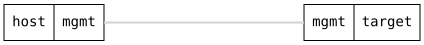

=== Who Am I

ifdef::topdoc[:imagesdir: {topdoc}../../test/case/system/whoami]

==== Description

Verify the infix-system:whoami RPC.  It returns the name of the calling
user and the NACM groups that user is a member of.  The factory NACM
rules deny guests all RPCs but this one, since a guest cannot read the
NACM configuration to find out.

==== Topology

==== Sequence

. Set up topology and attach to target DUT
. Add user jane to NACM groups guest and operator
. Verify whoami as admin returns admin, in group admin
. Verify whoami as jane returns jane, in groups guest and operator
. Verify jane cannot read the NACM groups

