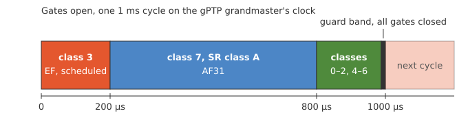
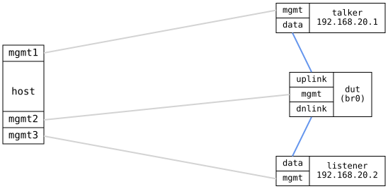

=== TSN Gate Timing

ifdef::topdoc[:imagesdir: {topdoc}../../test/case/use_case/tsn_gate_timing]

==== Description

Check frame by frame that a bridge port's gate control list sends each
traffic class only inside its window, timed by the gPTP grandmaster's
clock.

The DUT bridges a talker and a listener and is the IEEE 802.1AS (gPTP)
grandmaster on both ports, so all three clocks share its time.  The
port toward the listener uses the `ieee-sr` traffic class preset and
runs a 1 ms IEEE 802.1Qbv gate control list, the same as in the TSN
Schedule test.  Class 3, scheduled traffic, gets 0 to 200 µs and
class 7, SR class A, 200 to 800 µs.  The remaining classes get the
rest of the cycle up to a guard band, 12.3 µs at 1 Gbps, when all
gates are closed.

.The gate control list on the DUT's port toward the listener

The talker sends `ptping` probes, UDP datagrams timestamped in
hardware when they leave the talker and when they reach the listener.
There are three streams, marked EF, AF31 and CS1, which the DUT
classifies with the default `ietf` DSCP map to priority 5, 3 and 1,
and so to class 3, 7 and 0.  Each stream sends one probe every
1.003 ms, so its probes reach the DUT at every point of the cycle in
turn.  A probe that reaches the DUT while its gate is closed must wait
for the gate to open.  Every probe must thus arrive at the listener
inside its class's window, give or take a few microseconds for the
time a frame takes on the wire and for clock error.

The DUT forwards the probes like any other traffic, even though they
are PTP Sync messages: it takes only multicast PTP to its own clock.

==== Topology

==== Sequence

. Set up topology and attach to the DUT, talker and listener
. Bridge the DUT's ports, classify by DSCP, start gPTP
. Set up the talker and listener as gPTP time receivers
. Verify the DUT is grandmaster and the talker and listener follow it
. Run the gate control list on the DUT's port toward the listener
. Start a ptping sink on the listener
. Send EF, AF31 and CS1 probes through the DUT at every point of the cycle
. Verify EF probes arrived between 0 and 200 µs into the cycle
. Verify AF31 probes arrived between 200 and 800 µs into the cycle
. Verify CS1 probes arrived between 800 µs and the guard band

