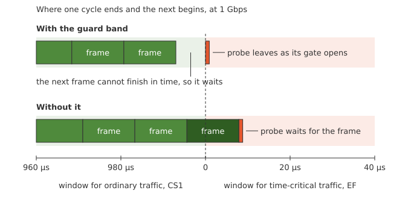
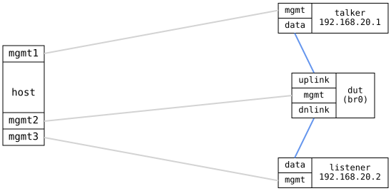

=== TSN Guard Band

ifdef::topdoc[:imagesdir: {topdoc}../../test/case/use_case/tsn_guard_band]

==== Description

A scheduled port gives time-critical traffic a window of its own in
every cycle.  That only helps if the window starts on time: a large
frame of ordinary traffic that starts just before the window is still
on the wire when it opens.  The guard band prevents this.  The port
holds back a frame that cannot finish before its gate closes, as IEEE
802.1Q-2022 8.6.8.4 specifies.  This test checks that it does, with
the port fully loaded.

.The end of a cycle, with and without the guard band

The DUT bridges a talker and a listener and is the IEEE 802.1AS (gPTP)
grandmaster on both ports, so all three clocks share its time.  The
port toward the listener runs a 1 ms gate control list: time-critical
traffic, class 5, for the first 200 µs and every other class for the
remaining 800 µs.  The list has no guard band entry of its own, so
holding frames back is left to the port.

The talker floods the port with full-size frames of ordinary traffic,
marked CS1, at 900 Mbit/s.  That is more than the 800 µs window
carries, so a frame is always waiting when the window closes.  At the
same time it sends time-critical `ptping` probes, marked EF and
timestamped in hardware.  One leaves every 1.003 ms, so the probes
reach the DUT at every point of the cycle in turn.

A probe that reaches the DUT during the CS1 window waits for its gate,
and must arrive at the listener within 5 µs of the gate opening.
Without the guard band a third of them arrive up to 16 µs late.

==== Topology

==== Sequence

. Set up topology and attach to the DUT, talker and listener
. Bridge the DUT's ports, classify by DSCP, start gPTP
. Set up the talker and listener as gPTP time receivers
. Verify the DUT is grandmaster and the talker and listener follow it
. Run the gate control list on the DUT's port toward the listener
. Start a ptping sink on the listener
. Flood CS1 at 900 Mbit/s through the DUT
. Send EF probes through the DUT at every point of the cycle
. Verify the CS1 flood ran until the last probe
. Verify EF probes that waited for their gate left as it opened

