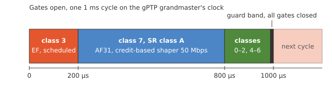
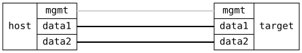

=== TSN Schedule

ifdef::topdoc[:imagesdir: {topdoc}../../test/case/use_case/tsn_schedule]

==== Description

Run gPTP, a gate control list and a credit-based shaper together on one
bridge port, the usual TSN setup, and check that each traffic class
gets the share of the port its schedule gives it.

The egress port is an IEEE 802.1AS (gPTP) grandmaster, so the gates
run on its clock.  Its traffic classes follow the IEEE 802.1Q-2022
recommendations for a port carrying reserved streams.  The `ieee-sr`
preset, Table 34-1, puts SR class A, priority 3, in class 7, the
highest class.  Class 7 runs an IEEE 802.1Qav credit-based shaper
reserving 50 Mbit/s, the other classes are strict priority.

The IEEE 802.1Qbv gate control list repeats every 1 ms.  It opens a
protected window for class 3, scheduled traffic at priority 5, then a
window for class 7, the reserved stream, then one for the remaining
classes.  The cycle ends with a guard band, all gates closed for as
long as a maximum-size frame takes, so no frame from the last window
can overrun into the protected one.

.The gate control list on the egress port

The ingress port classifies three flows by DSCP with the default
`ietf` map, RFC 4594:

* EF, priority 5, to class 3, at 100 Mbit/s.  It fits in its window
  and must arrive intact.
* AF31, priority 3, to class 7, at 40 Mbit/s, below its reservation.
  It must also arrive intact.  The shaper earns credit only while the
  gate is open, so this holds only if the reservation is scaled up to
  make up for the time the gate is closed.
* CS1, priority 1, to class 0, at 400 Mbit/s, more than its window
  can carry.  It must be held to what fits in the window.  The test's
  own iperf3 control traffic, CS0, goes to class 1 in the same window.

Last, EF runs alone at 300 Mbit/s and must also be held to its
window.  Without the gates, strict priority would let it through at
line rate.  What a window carries is the number of whole frames that
fit in it at the port's speed, within 10 percent: about 184 Mbit/s for
a 200 µs window at 1 Gbit/s.

==== Topology

==== Sequence

. Set up topology and attach to target DUT
. Bridge the two ports, classify by DSCP on ingress
. Start a gPTP grandmaster on the egress port
. Verify the DUT is its own grandmaster and the port transmits time
. Run the gate control list on the egress port, reserve 50 Mbit/s for class 7
. Set up the talker and listener namespaces
. EF at 100 Mbit/s, AF31 at 40 Mbit/s and CS1 at 400 Mbit/s
. Verify EF and AF31 arrived intact
. Verify CS1 was held to what its window carries
. EF alone at 300 Mbit/s
. Verify EF was held to what its window carries

